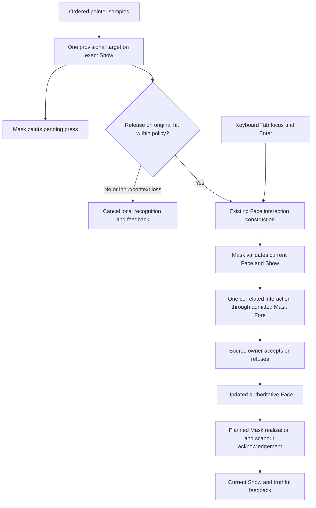

# Gestures and semantic activation

A gesture is a bounded, recognizable pattern of input through which a
participant may express an intention. Keys, taps, drags, timed remote sequences,
voice commands and gaze dwell differ in recognition, not in application meaning.
Gestures accelerate meaningful operations; they must not be their exclusive
entrance when another suitable input can express the operation.

This document applies the existing [canon](../conduit-canon.md#execution-and-face)
Face/Mask boundary. It proposes an incremental activation correction, not a
universal gesture framework, new authority mechanism or additional scheduler.

## Current implementation audit

Audited against development source `5d4116ad98`, with separate inspection of
open [#6895](https://github.com/dancxjo/conduit/pull/6895) at `58c9d69197` and
[#6905](https://github.com/dancxjo/conduit/pull/6905) at `800616d945`.
Those PRs remain their owners' work, not merged development capabilities.

| Responsibility | Confirmed owner and behavior |
| --- | --- |
| Physical ordering and loss | `targets/conduitos/src/pointer_state.rs` retains button state and sample sequence across foreground/Show changes. Invalid, dropped or coalesced history refuses. USB reports are observations, not Face authority. |
| Native hit routing | `native_compositor/input_routing.rs` routes only to an admitted visible surface and checks its manifestation. Routing with `activate=true` changes surface focus; routing alone is not a semantic invocation. |
| Native focus, reading and editing | `native_face_scene/input.rs` owns control focus, page/view movement and bounded drafts. Tab moves control focus; Enter submits; Escape discards the local draft. Boolean choices have their own typed interaction path. |
| Native activation | `product_front_door/pointer_input.rs` computes a rising primary-button edge and immediately calls `FaceArrival::accept_pointer`. `native_face_mask/input.rs` resolves the current hit and `NativeFaceScene::pointer` can commit it immediately. **Confirmed defect: button-down can invoke before a tap completes.** |
| Exact interaction and Show acknowledgement | `NativeFaceMask::submit`, `native_mask_play/interaction.rs` and `semantics/face/src/mask_show.rs` validate the exact offered interaction and consume its session. Producer/Mask execution and compositor scanout precede the acknowledged Show. Local cursor paints do not acknowledge a new semantic Show. |
| Domain effects | The source owner applies the returned `FaceInteraction`. A Mask submission is a request, not evidence that the owner accepted or completed it. |
| Browser activation | `targets/browser/handbook/owner-face-presentation.mjs` creates native buttons/forms and typed choice controls. Form submission checks reachability, current render, availability and arguments, then disables dispatch before calling its owner adapter. This uses platform activation semantics; it does not use native button-down routing. |
| Shared Linux input in open #6895 | `products/conduit/src/durable_host_presentation/native/input.rs` retains physical button state outside the Show and sends a rising-edge `activate` flag to the selected native Mask adapter. This is a separate adapter entrance requiring coordinated qualification, not proof that changing the ConduitOS entrance fixes the deployed SDL route. |
| Nonvisual realization | `semantics/face/src/spoken_mask.rs`, `products/conduit/src/cli/spoken_mask.rs` and screen-free product routes retain ordinary planned spoken/linear presentation and owner actions. Produced audio, device playback and attended speech interaction are different proof classes. No live speech-recognition equivalence was established in this audit. |

The native emulator producer in
`targets/conduitos/make/xtask/journey_proof/creche_pointer.rs` currently waits
for a Source change **before releasing** the button. Its version-1 receipt
binds the later release to the refreshed Show. That proves the old press-edge
behavior; it cannot qualify release activation. Preserve historical receipts
and add an explicitly versioned successor when correcting the journey.

[#6667](https://github.com/dancxjo/conduit/issues/6667) remains a deferred
page-overview gesture. Its acceptance already requires visible alternatives,
cancellation, finite lists and preservation of Show bindings. It is not an
existing universal gesture/arbitration implementation. #6895 owns current SDL
input and navigation dispatch; #6905 owns exact reading-position preservation.
Neither should be replaced or absorbed by this audit.

## Meaning and ownership

The Face offers meaningful subjects, relationships, properties, actions and
interaction context. The Mask interprets input and realizes feedback over that
exact Face. A Mask remains an ordinary planned Plot: it cannot acquire ambient
authority or mutate Body truth independently.

The document/user-agent analogy explains alternative realizations of common
meaning. It does not make a Mask an independently sovereign user agent.

| Concept | Meaning and boundary |
| --- | --- |
| Navigation | `Place × Aspect × Focus × Depth`; existing `ENTER`, `SHOW`, `FOCUS`, `FOLLOW`, `DISCLOSE`, `BACK` requests retain exact context correlation. |
| Local control focus | Where keyboard or other input is directed within a Mask. It does not itself select or activate a semantic subject. |
| Selection | A source-owned typed choice, or explicitly identified local presentation choice. It is independent of focus and activation. |
| Activation | A request to `INVOKE` the offered semantic action through current Face/Show authority. |
| Editing/adjustment | A bounded draft followed by an offered typed operation. A recognizer does not edit Body state. |
| Gesture cancellation | Abandon a pending interpretation, without submitting an action. |
| Operation cancellation | A distinct offered request to stop an operation; its observed outcome comes from lifecycle truth. |
| Back | Navigation within a context, not implicit cancellation or undo. |
| Undo | An explicitly supported semantic reversal; absence of such an action is not permission to synthesize one. |

## First activation slice

Use one real ordinary Face action, such as Crèche Suggest, through both native
pointer and normal Tab/Enter navigation. Reuse the existing checked interaction,
Mask Fore and source-owner mutation. Do not introduce a second command enum.

The bounded tap recognizer owns at most one provisional target. It records the
exact Show basis, target and view, and the press origin. A physical rising edge
can acquire it; a held sample on a replacement Show cannot. Hit testing on
button-down may draw pressed feedback but must not submit a semantic operation.

For the initial native policy, release over the original hit completes a tap
only if movement never exceeds eight display pixels on either axis. Leaving the
hit cancels permanently for that press, even if the pointer returns. Input loss,
stale Show, view replacement or competing keyboard input cancels ownership.
The threshold is a declared native policy, not a universal touch or accessibility
requirement. No timer, long-press recognizer or drag implementation is implied.

A cancelled press cannot rearm until another physical press edge. A completed
release enters the existing semantic pointer activation path once. Existing
session consumption prevents a second invocation before a fresh acknowledged
Show. Keyboard activation uses its own normal focus/key state and reaches that
same semantic action without borrowing pointer state.

Pressed feedback must differ visibly from keyboard focus even when the target
was already focused. It reports pending recognition, not optimistic owner
success. Removing the pressed marker reports the end of that pending state.
Existing typed refusal notices and owner-refreshed Faces report refusal and
accepted effects; asynchronous completion must retain actual lifecycle truth.

## Proposed module ownership and proof

Keep physical sample validation in `pointer_state`; keep compositor routing about
surface identity and geometry. Put the single-target recognizer in
`native_face_scene/pointer_gesture.rs`, with no application callbacks. Keep
`native_face_mask/input.rs` as the bridge to current Show validation and local
repaint. The product entrance forwards press, hold and release rather than
calling semantic activation on the rising edge. Scene replacement discards
pending recognition, even where an independent reading/draft contract permits
other encounter state to survive.

The pending record must have fixed storage; do not retain an old Face, action
or Show as execution authority. Reuse admitted rendering commands for pressed
feedback. Existing finite frame, text and surface limits remain unchanged.
Do not silently fall back to a private overlay or increase limits to draw it.

Regression proof must cross physical-sample recognition, actual Mask Play/Fore,
current Show checks and the real source owner's action. Compare pointer and
keyboard resulting owner Faces. Include held reports, repeated release,
movement, leaving/returning, input loss, Show replacement and keyboard conflict.
Prove focus, selection, navigation and activation separately. Recognizer-only
unit tests are insufficient.

`cargo xtask check input-semantics` is the existing deterministic validation
entrance. The native emulator journey additionally needs the release-based
producer and successor receipt. Pinned browser acceptance, physical touchscreen
use and human enactment remain separate proof; none is claimed by this document.

## Follow-up slices

1. Coordinate the native activation patch and release-based emulator proof with
   #6895's selected Linux Mask adapter and #6905's reading-position owner. Do
   not open a third overlapping implementation review without a handoff.
2. Qualify the same action with pinned Chromium input and actual native display
   captures. Retain the ordinary visible keyboard alternative and exact refused,
   unavailable and stale dispositions.
3. Extend arbitration only when adding a concrete competing drag/scroll or
   long-press recognizer. Declare capture, thresholds, loss and bounded work at
   that seam; preserve #6667's overview scope separately.
4. Add controller/remote sequences and one nonvisual activation of the same
   semantic operation through the existing Face authority. Distinguish recorded
   speech from live recognition and actual assistive-device proof.
5. Add a bounded recognizer extension seam only after a second materially
   different recognizer establishes its required inputs and outcomes. Gaze and
   unconventional hardware need no speculative device framework now.

## Horizontal page reading

The shared native Mask interprets a left swipe as next page and a right swipe
as previous page, using the same local reading controls as the footer. It never
constructs a Body interaction or consumes the acknowledged Show. This policy
is independent of the device and operating system that supplies ordered pointer
samples; an adapter's availability and physical touchscreen proof are separate.

Recognition retains one press origin, optional tap target and exact Show/view
basis. Release must travel horizontally at least the greater of 48 logical
pixels and one fifth of the surface width. Vertical travel over 24 logical
pixels permanently disqualifies the swipe. Movement over eight pixels or
leaving the original hit permanently disqualifies the tap, even if the pointer
returns. Losing a tap does not prevent completing a horizontal page swipe.
There is at most one page turn per release, and the first/last page never wrap.

Swipes are eligible only where the existing local page controls are available:
not during editing, a local notice, or diagram reading. Input loss, changed
Show/view and competing keyboard input cancel the pending gesture; held samples
cannot rearm it. No timer, velocity estimator, history buffer or extra rendering
budget is introduced. The existing footer and keyboard routes remain available.
