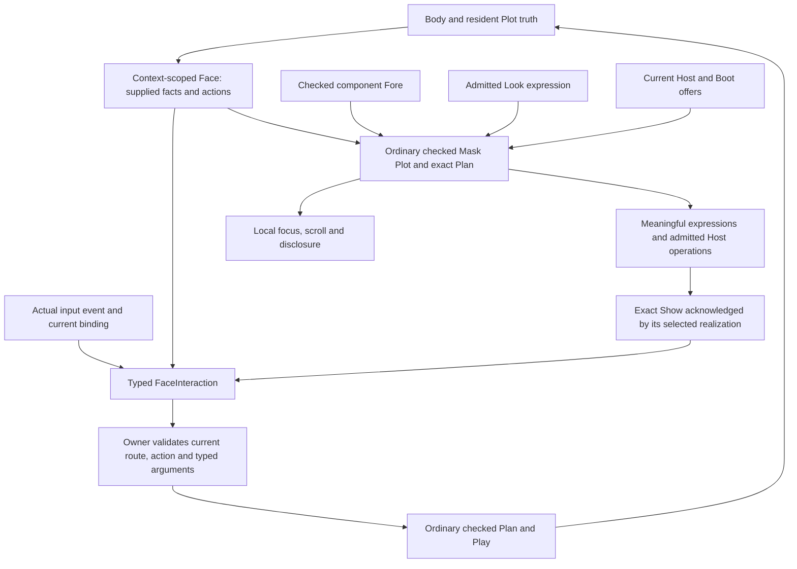

# Checked Face-to-renderer correspondence — #5372 draft

Status: #5372 implementation draft based on accepted #5355. Its tested source
`a46b065125935e0c2a67a8ae1dc7f3c159360022` was accepted on main at
`b6e762e30bf72583d2c4c0db0db30a52183ae29a` with the identical tree. This document
does not establish #5372 completion.

## Ownership and mapping

Face owns domain meaning and offered agency. A component owns its checked Fore;
a Look owns expression policy; the Host owns offered mechanisms. A Mask realizes
those contracts. The Owner remains the authority for source-affecting execution.
No renderer callback acquires a second mutation authority.

## Existing values form the witness

Keep four obligations separate:

1. **Semantic coverage:** the requested Face projection supplies exact subject,
   relationship, status, wording, action, availability and typed argument facts.
   An unfamiliar valid identity keeps its exact identity and honest human fallback.
2. **Realization:** `MaskPlot` checks the face/interaction/show Fore;
   `PlannedMaskPlot` retains the verified ordinary Plan and exact placements.
   Meaningful expressions identify their supplied facts/actions; local decoration
   need not name an application action.
3. **Encounter:** `MaskShow` retains Face identity/revision, producing Mask Plan
   and Play, placement and Show lifecycle. Prepared is not Available. The selected
   realization must acknowledge its own occurrence.
4. **Return:** `FaceInteraction` names the exact Face/revision/Show, offered action,
   target, typed arguments and event sequence. Current device bindings and the
   owner-issued route remain separately validated custody.

`MaskShow::correlate_interaction` checks identity/revision/Show correlation only.
It does not prove availability, argument validity, current Host truth, device
binding or authority. Preserve the consuming Mask and Owner checks. Serialized
inspection records describe these obligations; they cannot mint runtime grants.
No new execution type is currently justified by the inspected seams.

## Concrete examples

**Parsec Start:** checked source emits a Begin instruction for the current admitted
control. The instruction Source and terminal effect keep their original bounded
values and exact Body/Mask/Host custody. An acknowledged effect may make input
eligible. A remap changes binding and wording; the Face action and Look retain
separate identities. Missing or outdated binding cannot retain a truthful Begin
claim. Spoken wording requires the actual speech offer before planning.

**Todo Add:** generic and checked component realizations can offer the same
`todo.add` action with its bounded text argument. Pointer activation and keyboard
activation must each traverse the actual selected browser Mask Fore and current
owner route. The initiating Show and typed argument correlate with a verified
ordinary owner mutation receipt. A new committed state yields a fresh Face and
Show; the old initiating return refuses before another effect.

The retained generic/compact/spacious comparison already has distinct admitted
Mask Plot, Plan, Play and Show identities for one unchanged Face. Its comparison
has no domain mutation. The retained DOM mutation journey does commit effects,
but its keyboard assertion currently proves focus reachability only. Join those
existing boundaries in a fresh bounded fixture; do not infer the missing event
or effect from separate receipts.

## Updates and refusal

| Change | Required behavior |
| --- | --- |
| New Face revision/context | Reproject and prepare a new encounter; retire prior action bindings |
| Device remap | Recheck current source binding and regenerate truthful instruction before input eligibility |
| Local focus/scroll/disclosure | Change local encounter state without fabricating a domain action |
| Unsupported medium/Host | Refuse before effect or expose an admitted reachable fallback |
| Lost Host/Boot/offer generation | Retire the route and Show; preserved identity strings cannot restore authority |
| Stale Show/revision or sequence | Refuse before owner mutation |
| Unavailable action/invalid arguments | Refuse before checked execution; do not reinterpret or coerce the proposal |
| Hidden essential action/misleading wording | Detect failed encounter coverage and refuse that claimed realization or use truthful reachable fallback |

An expression need not correspond one-to-one with a semantic operation. One
action may have several gestures/media; an expression may convey several facts.
The requirement is inspectable provenance and preserved agency, not equal counts.

## Bounded executable proof

Reuse one retained Todo Body and the #5355 harness. Select generic and checked
component realizations through their actual owner-issued routes. Record their
independent Plot/Plan/Play/Show identities. Invoke the same persistent offered
Add action once by pointer and once by keyboard; verify each committed effect,
original source/action/typed argument correlation and the fresh state between
returns. The second invocation uses its current Face revision, rather than
pretending effects leave Face identity unchanged.

Negative cases must cover a painted inaccessible pseudo-control, omitted action,
forged action/target/arguments, stale Show/revision, outdated device binding,
disabled action and misleading instruction. Check lack of effect through ordinary
owner state/receipt observation. Preserve local focus and disclosure positives.
Use pinned Chromium, one worker, zero retries and actual event activation. Do
not substitute direct callbacks for the missing keyboard event or change the
existing retained proof owner during design reconnaissance.

## Named implementation boundaries

- #5372 owns this correspondence specification and joined bounded witness.
- #5369 owns device-to-action binding and truthful input instruction custody.
- #5365/#5378 own reusable component Plot/Fores and checked assembly.
- #5368 owns Look separation; #5366/#5377 own richer Look/source authoring.
- #5367 owns platform accessibility lowering; #5376 owns selected browser components.
- #5379 owns CSS admission that preserves required reachable agency.
- #5380 owns source-checked spoken templates; speech delivery and human enactment
  retain their own proof boundaries.

If a negative reveals a missing production admission check, retain the concrete
counterexample and assign the smallest correction to its named owner. Do not add
a universal Button Kind, a second semantic tree, a Mask graph language, unrestricted
callbacks or another scheduler. #5372 completion still requires the joined
fixture, negative evidence, required validation and accepted integration.

## Acceptance coverage ledger

| Requirement | Reuse basis | New evidence still required |
| --- | --- | --- |
| Mapping/ownership and exact source-to-Show/return examples | Diagram and four obligations above; ordinary Mask Fore/Plan/Play | Accepted document and executable correspondence record |
| Two admitted realizations, two inputs, committed effect | Historical distinct generic/component Plans; actual retained DOM mutation receipts | Fresh pointer and keyboard returns with each own Show and verified ordinary owner effects |
| Parsec Start plus Todo/state mismatch | Current Start/Shoot/remapped Enter Body admission tests and checked instruction frames | Include current binding/effect cases in the correspondence witness; do not substitute captured IDs for input custody |
| Invalid/inaccessible/misleading encounter refusal | Existing stale/action/argument/availability checks and component wording refusals | Painted pseudo-control, omitted essential action and inaccessible realization counterexamples before effect |
| Local focus/disclosure remain possible | Existing retained DOM focus/disclosure and native local operations | Preserve same domain truth during those local transitions |
| Separate component, Look, accessibility and device law | Existing named owners and typed boundaries | No duplicate action meaning or raw callback mutation path |
| Required source/Show/Host/Boot proof and integration | #5355 retained gates and original identities | Final #5372 exact-head tests, Candidate, accepted Integration and publication |

The Parsec half must reuse the actual current runtime boundary demonstrated by
`combined_body_admits_start_shoot_and_remapped_enter_from_completed_input`,
`remap_withdraws_space_and_requires_new_show_before_source_enter_instruction`
and `instruction_witness_requires_current_accepted_scope_and_exact_mask_play`.
The separate frame reconstruction checks are read-only evidence and cannot replace
those admissions. Ledger-only completion tests do not mint an input grant either.

The Todo half must verify its current `OwnerBrowserMask` route, actual input event,
Show acknowledgement and committed source result as one chain. A separately valid
component fixture plus a separately valid owner mutation is not that chain.
