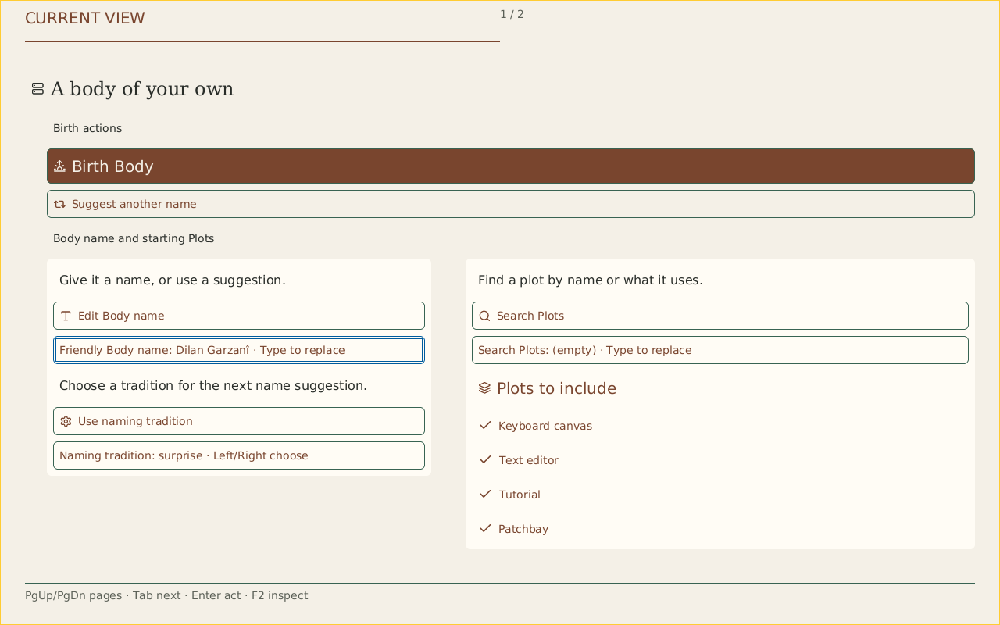
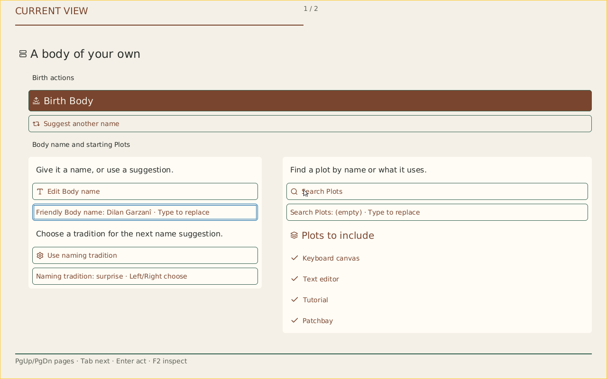
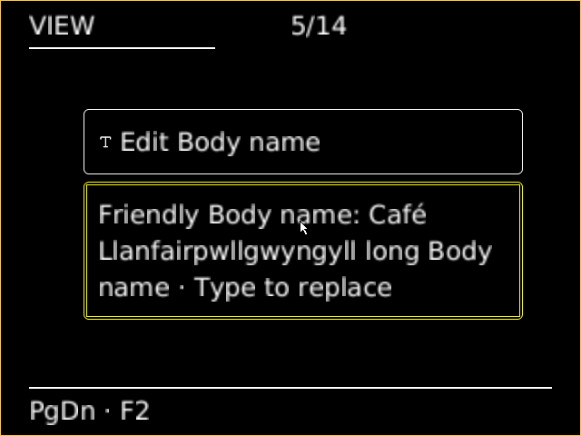
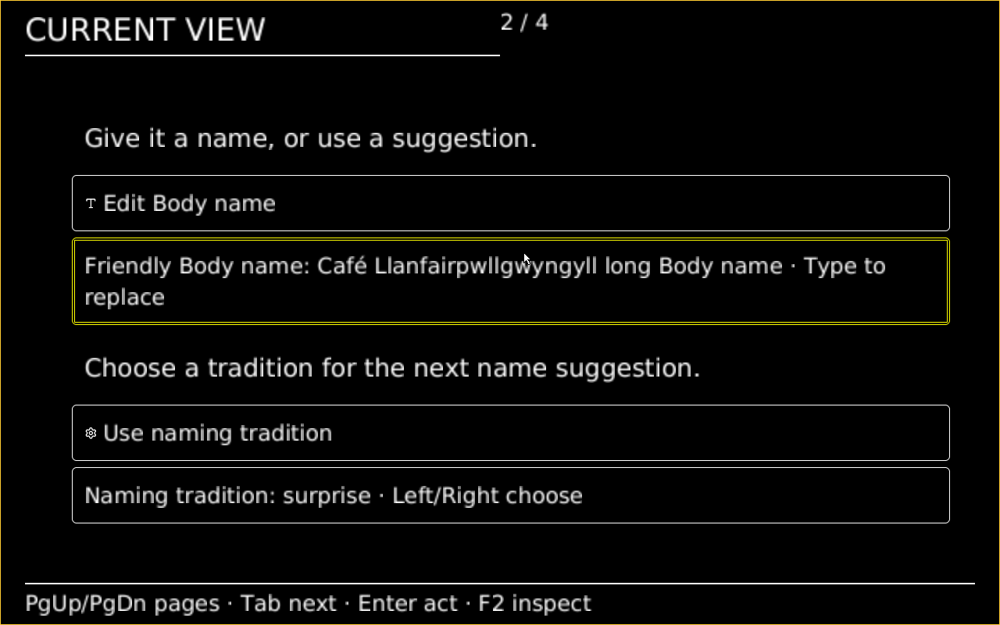

# Crèche reference comparison (#6174)

Latest color follow-up: Source 235297c3f now supplies a restrained navy Look
family with actual wide/narrow QEMU captures. [Same-Face Phosphor/navy comparison](evidence/gui-look-6349-native-navy/README.md)
moves the palette toward the reference while preserving source facts. This does
not complete metric/radius/depth or full-journey acceptance.

The user-supplied reference is pinned at `c8fdc8949a426873364665abd98bf8dc34edf98c`.
The retained typography comparison captures below are from clean Source `e34b12788`,
with exact image/Root/PNG bindings and the later journey failure retained in
[the evidence record](evidence/gui-look-6349-native-engineering/README.md).
This is a visual comparison and gap audit, not completed reference acceptance.

| Requested reference | Actual native Editorial, 1280×800 |
| --- | --- |
|  |  |

| Reference detail | Current native result and remaining work |
| --- | --- |
| Serif lead title; quiet Sans controls; technical Mono | Actual serif title and Sans controls are visible. F8 now selects the admitted Sans title over the same Face/component/recipe/layout; all eight typography/density/palette combinations pass a ten-transition actual QEMU check. Further scale/weight refinement remains measured resource work. |
| Restrained navy, inset surfaces, subtle separators | Current Phosphor is darker with stronger cyan/amber; Editorial offers cream surfaces. Both consume actual canonical Look paint. A closer restrained navy expression and supported depth remain visual refinement; no blur or runtime loader is implied. |
| Aligned naming and Plot groups | The actual checked responsive structure places naming and catalog side by side in compact wide mode. Spacious mode uses its admitted continuation; identical complete Face/recipe/layout bindings survive the swaps. Current narrow/large-text reachability still needs its own proof. |
| Body/edit/search/Plot icon rhythm | Finite shared Host, Birth, edit, search, collection and Boolean indicators appear. The title's Host icon follows its actual Face role; it is not relabeled to imitate the drawing. Decorative omission under residual capacity remains allowed. |
| Gold focus and comfortable targets | The actual name field retains gold focus under Phosphor; the paper Look selects blue. Focus/paint change without semantic action dispatch. Wider/native pointer, unavailable-control, forced-color and 200% correspondence retain their required scope. |
| Primary Birth and secondary suggestion | The real available Birth action has stronger fill and type. Suggestion remains labeled and available; subdued reference paint cannot disable it. |
| Page position and quieter footer | The actual header's `1 / 2` and proportional line describe local continuation. The footer retains keyboard guidance. Neither represents workload progress. |
| Example name and unchecked Plot examples | The real generated name and four source-selected Plots remain authoritative. These are deliberate semantic differences, not visual defects to fix by repainting state. |

The ten Look transitions preserve the same complete Face, component Fore,
recipe/layout and action records, with distinct acknowledged local Shows.
Compact pages remain at 48 commands. These facts do not establish every control
on every continuation page or remote owner acknowledgement.

The fresh normal image builds and boots, but Application target preparation
during Plan exhausts its existing work quota before the editor or Patchbay.
The scoped local Look check passes; full journey/compositor-lifecycle,
exact-tree integration and publication acceptance remain unproved. Earlier
`dd5349718`/`6034b2c17`/`a161ac474` receipts remain source-specific historical
proof; they are not silently promoted to this Source.

## Actual typography comparison

| Editorial title, paper palette | Engineering title, same paper palette |
| --- | --- |
|  |  |

These two captures share the exact Face, checked structure and paint tokens;
Engineering changes the selected pinned title profile. The same native type
choice also passes with Phosphor and both densities. This is not a claim that
the browser's separate cool Engineering application preset has native pixel
parity. Current local Crèche narrow/200%/forced-color and every continuation
control still need actual correspondence proof. The restrained navy expression
of the original reference remains a visual refinement, not a completed gate.

## Current native accessibility follow-up

Source `7fb598899` now passes the scoped primary accessibility scenario at both
640×480 and 1280×800 with the same normal product ISO. F9/F10 apply the existing
Host text minimum and forced-color policy; F6/F7/F8 retain those requirements
while changing density/palette/type. Long Unicode name, both complete primary
keyboard cycles and exact order, every primary page and actual pointer focus
retain full Face/Show correspondence. The reusable field-pagination correction
keeps fitting action/argument pairs together when help must continue.

| Actual 640×480, Engineering at 200%/forced colors | Actual 1280×800, same scenario |
| --- | --- |
|  |  |

[The exact receipts and capture scope](evidence/gui-look-6349-local-a11y/README.md)
supersede the earlier pending local-primary 200%/forced-color/narrow checks for
this Source. They do not complete Details, every unavailable-control/resource
fallback case, the restrained navy expression or the full Body journey. No
integration, publication, physical or human acceptance is implied.

## Wide Details follow-up

Source 8b9f820f9 now proves wide Details keyboard and continuation at 200% in
two forced-color Looks, with explicit scene-mode observations. All sixteen
typed controls and nineteen/twenty-three pages pass. This supersedes the pending
wide Details traversal only; narrow Details and unavailable/resource cases remain.
[Source-bound captures and proof boundaries](evidence/gui-look-6349-native-details/README.md).

## Narrow Details with shared icons

Source 18f653cf4 now passes every narrow Details page and both keyboard directions
at 200%/forced colors in separate Editorial and Engineering runs (56/71 pages).
Shared explicit role/intent icons decorate subjects/actions without changing
wording or contracts. [Exact captures and bounded scope](evidence/gui-look-6349-native-details/README.md#narrow-details-and-shared-icons--source-18f653cf4)
supersede the pending narrow Details navigation scope only. Unavailable/resource
cases, closer navy reference and full Body journey remain open.
