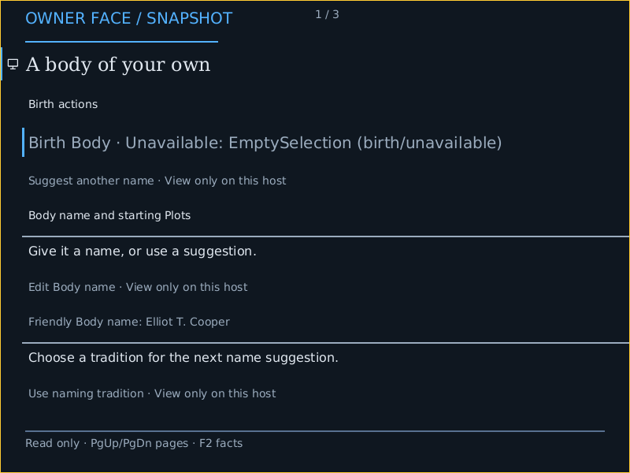

# Actual AArch64 normal-product first frame

The normal graphical PROFILE at source06bf2d320 built and booted in actual QEMU virt/neoverse-n2 with firmware ramfb. It displayed the canonical read-only zero-Body BirthDraft through the existing Source forwarding producer, checked native Mask and acknowledged Available Show. No Body was born or candidate Body Plot executed. Independent review joins the exact Root ELF in the ISO, manifests, raw serial identities, producer Source/Checked/Expanded/Plan, Mask Plan/Play/Show, observatory framebuffer and800x600 PNG/PPM pixels. Actual pixels_written505397; this is work count, not timing.

The capture subprocess reached successful QMP and complete serial records, then exited1 because Pillow was absent during PNG conversion. Both the original receipt and failure log remain. The same captured PPM was converted losslessly with standard-library PNG chunks; there was no replacement guest run, scaling or image edit. The packet contains actual compressed ELF/ISO and every original capture file; manifest hashes refer to decompressed originals.

Open pre-PR issue: the renderer footer advertises PgUp/F2 although this product has no local input reader. Serial correctly says interactive_local_control=false. Remove or qualify these inactive affordances before coherent local-control UX is claimed. A graphical-aware supported boot collector and persistent interactive launcher remain work too; the existing generic AArch64 boot collector is serial-only.

This source is prepared from dev3b3f539 plus the held AArch64 graphics branch. Later dev49f9628 and subsequent PRs were not in this image. The CPU tests/strict hosted Clippy ran at earlier08c222b39 with identical helper source; final06bf changes the AArch64 entropy reference to the existing exported alias and passes the actual AArch64 check and normal PROFILE build. Earlier producer refusal, wrong test assertion and missing entropy export are preserved at their exact sources.

This is one architecture first-frame proof, not full issue6057 closure, accepted dev/Candidate/Integration, cross-architecture semantic parity, physical scanout, input support, GPU acceleration or service containment. IA32 firmware acquisition, other architecture frames, comparative gallery, truthful capability matrices and the separate persistent launcher remain in the original issue scope.
