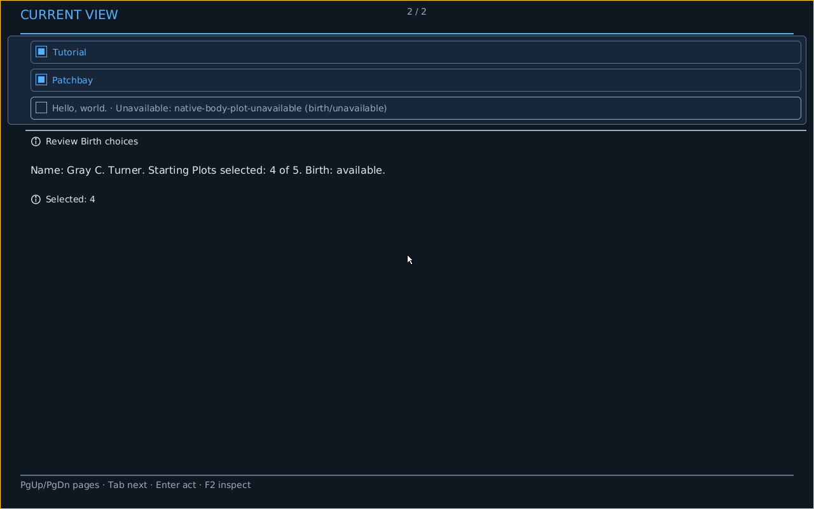

# Crèche continuation: source-bound after-side controls

Two single supported `cargo +stable xtask make conduitos creche-controls-proof --viewport <extent> --locked` attempts passed on frozen clean **eb77aad03dae3654709e8004f617d48550e95a9d**. Its normal merge preserves development50360's already-landed #6205 continuation allocator unchanged; the proof/test branch adds no product layout, authority or budget change. This documentation successor was not executed.

| Current after-side | Original PNGs | All primary page receipts | All Details page receipts | Available controls | Checked naming changes |
| --- | ---: | ---: | ---: | ---: | ---: |
| 1280×800 | 12 | 2 | 8 | 12 | 4 |
| 640×480 | 13 | 3 | 21 | 12 | 4 |

All 25 PNGs are unchanged QMP originals, with serial-prefix, byte/dimension/decoded-RGBA custody. Primary first/middle/last sampling covers all 2/3 actual primary pages. Details screenshots cover 1/4/8 wide and 1/11/21 constrained; every other Details page has an original focus receipt, **not a pixel claim**. Source wording is not OCR or a claim about every unsampled rendered row.

## Labelled wide page 2 before/after

Both images are actual 1280×800 primary-page 2 captures after the **second explicitly selected compact/phosphor100** component realization, before the checked ASCII probe-name edit. They retain distinct actual Source/image/Host/Boot/Face/Show/draft identities. Initial names differ; do not assert identical full Faces, pixel equality or identification of the original user's unknown image.

| Pinned reproduced before-side | Current continuation after-side |
| --- | --- |
| Source 8c3ecb0d762dbb2e1e3b079f3f033d80fa44cff0; ISO 641aa4cc0da375e2dbe895497804b0b06bac0fd155379bbb4ed19a864a525e3f | Source eb77aad03dae3654709e8004f617d48550e95a9d; ISO 13a26e4f529a3943ca691c8816f155e031b02ca0cbb768e0a3bf30ca56726ee1 |
|  |  |

The [immutable before packet at 4b2ce922](https://github.com/dancxjo/conduit/blob/4b2ce922e89db1e96b606a64e4b82f36a03fe961/docs/audits/evidence/creche-selected-controls-20261022/README.md) binds the actual reopened arrangement: Tutorial/Patchbay/unavailable Hello in the upper-right, empty left region, review/4-of-5 below. This reproduces the reported arrangement on a known source/recipe/extent without pretending to recover the original attachment's running image or guest viewport. The after primary 2 uses full-width remaining choices followed by review. Root visually inspected it, the coherent wide Welsh field, and all three constrained primary pages. Current guest constrained layout remains three primary pages. The separate fixed checked probe-name captures are retained; initial draft differences are not hidden by calling those earlier captures matched.

## Exact Source and interaction evidence

Both runs retain five actual Plot actions: four Available/selected and Hello explicitly Unavailable with reason `birth/unavailable`, explanation `native-body-plot-unavailable`. Independent root verification confirms those facts remain unchanged across all seven complete acknowledged NativeFaces in each run. All twelve available native controls complete forward/reverse cycles; unavailable Hello remains visible Source/reading evidence, not an invented available focus control. Boolean Plot toggles combine action/argument realization rather than pretending a separate hidden argument control exists.

Each run makes exactly two real F6 selections, spacious/phosphor125 then compact/phosphor100. Original component-realization records bind the full fresh acknowledged Face/Show, current FOCUS, Boot/Host/generation, component/recipe/configuration/expression and Mask Plan/Play/manifestation. The Source Face and owner-effect counts remain unchanged; the second selected Show is the control baseline. Initial expression is not serialized: this is explicit selection, **not initial recipe restoration or fallback proof**.

The four actual checked naming Changes establish `Naming proof`, choose membership-derived Welsh, restore original tradition and restore the exact checked probe name. The original random friendly-name bytes remain observed before-state, not a universal Unicode-entry claim. Pointer evidence is calibrated field focus from actual bounds, press/release and a later released-motion dispatch barrier with unchanged Source/Face/Show/change count; the checked keyboard action performs selection. It is not click-to-select authority or replay of uncertain effects.

## Finite cost and sparse-page rationale

The unchanged `focused/` packet preserves the first 5ded failure and corrected eb77 checks, exact runners/patch/root receipts, and **753 byte-equal CPU row/cost records per source** across the fixture-access correction. The specimen mirrors actual installed-membership classification over five candidates/four selected/Hello refused, actual Source search text and a valid 64-byte Unicode name. It does not execute Host eligibility/admission and is not the randomly named guest's exact row-cost receipt.

Configured wide CPU page 1 uses 47/48 commands; one remaining command cannot admit another checked Plot control with text/decoration. Page2 uses 25/48 commands. At 640×480 the max-name specimen has four primary pages: its first three leave 19/16/18 vertical pixels; the final independent `Selected: 4` needs a 36-pixel row plus spacing. Review Birth choices/full name/4-of-5/Birth availability already appear on page 1; the last page is an additional short count with 332 pixels free. This explains that ordered boundary and preserves the sparse edge rather than declaring all whitespace unavoidable or globally minimal. The actual guest has three pages, not four. Existing limits remain 48 commands/192 bytes per command/20 rows/eight surfaces. General layout design remains outside this bounded regression.

## Custody, checks and reproduction

Original local packets remain unchanged at:

- `/home/dancxjo/Documents/Codex/2026-10-21/please-finish-and-close-any-conduit/work/6158-eb77aad03-controls-1280x800-preserved`
- `/home/dancxjo/Documents/Codex/2026-10-21/please-finish-and-close-any-conduit/work/6158-eb77aad03-controls-640x480-preserved`

Both use canonical ProductHost ELF SHA256 `beee0a7c13399e39ba74c2dc304a6adace92749898671ea69c040945f6b8143d` and ISO SHA256 `13a26e4f529a3943ca691c8816f155e031b02ca0cbb768e0a3bf30ca56726ee1`. Both full target/resolved manifests, Boot and logical-vs-final image identities remain in receipts. Large ELF/ISO/map payloads stay local; `original-custody.json` records exact absolute custody paths, lengths/hashes and every deliberate omission. Raw `.log` originals are lossless gzip with mtime 0; all PNGs/receipts/seals are original bytes. The copied `focused/` stage is unchanged, including its own index and nested original custody.

Own first selected-controls verifier executions passed for both complete packets. Root independently repeated original-packet and five-choice checks: 61 sealed originals/25 PNGs and seven acknowledged NativeFaces per run. Scripts, source-scoped receipts and logs are under `verification/` and `independent-root-review/`. Compact `python3 verify-documentary-custody.py` checks stored bytes/lossless originals and SHA index, not omitted binaries. With full original local packet available:

```
/usr/bin/python3 verification/6158-verify-selected-controls.py /absolute/original-packet /new/result.json
```

Source 5ded passed 37 focused tests/xtask strict then failed native all-target Clippy because the integration facade lacked new symbols/private test-fixture access; formatting/native probes were unstarted. Corrected eb77 passed the affected 17 CPU + 2 integration cases, native all-target Clippy and workspace formatting. Unchanged 20 host tests/xtask strict stay 5ded-bound, not relabelled. The native pair used four jobs/default stack, no source/timeout/capture/render-budget changes, retries or convenient-Boot selection. Other owners' disjoint builds were active; no timing claim follows. Controls entrance does not run or claim four headless builds; the prior normal journey remains separate.

Earlier f842 capture-cap, 3ad compile, 4b15 lint and 9900 lint negatives remain immutably linked through the before/focused packets. No unknown original historical-image identity, generic fallback execution, all-Details pixel coverage, physical/human enactment, current Candidate/Integration or full #6158 closure is claimed by this local documentary successor.
