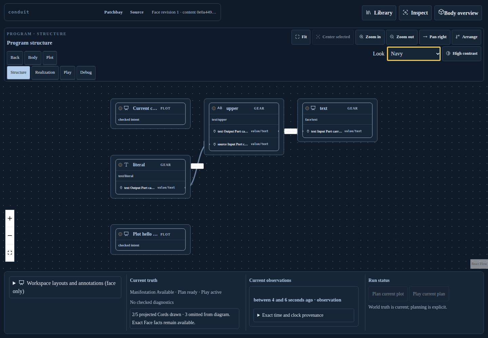
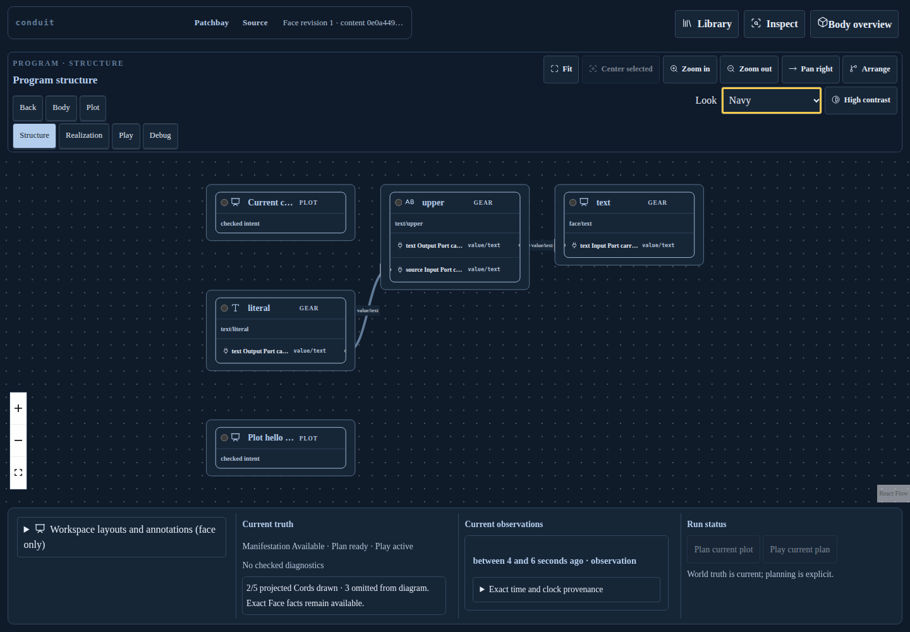

# Browser Patchbay Navy and readable Cord labels

Clean Source `e09d67b96957a5903a813fe0730f567142ae7641` passes the pinned Chromium
matrix with one worker and zero retries: nine Look/toolbar/inspector/layout cases,
exit 0, unchanged Source and a clean tree. These are actual local browser captures
of the documentary workbench, not live Body or owner-Mask acknowledgement proof.

## Product behavior

The application picker now offers Phosphor, Editorial, Engineering and Navy.
Navy is generated by the same finite CSS lowerer from the exact canonical
`navy_look(Compact, Editorial)` resource also used by native Crèche. No parallel
palette is copied into JavaScript. The four-Look stylesheet is 3914 bytes inside
the unchanged 6144-byte package/HTTP cap. Navy does not change the Face or graph.
The owner-acknowledged component picker remains a separate finite transport/catalog;
this application choice does not claim to extend that route.

Actual screenshots exposed white inline React Flow badge backgrounds overriding
the shared Look rule. Cord text was pale on white in dark Looks. The presentation
adapter now supplies the selected surface/text tokens as label paint props, without
changing labels, identities, endpoints, hit behavior or routing. Platform forced
colors also override graph paint tokens with Canvas/CanvasText/LinkText/Highlight.
Clearing that constraint restores the requested Navy palette without a Source edit.

| Earlier Navy with white Cord badges | Current Navy with readable badges |
| --- | --- |
|  |  |

## Verification and retained failure

- `picker-only/`: Source b9d6c523f passed the initial nine cases, which did not yet
  assert label contrast. It is retained as the visual before state.
- `contrast-before/`: test-only Source ef73f5617 on the same pre-fix binary fails
  the new read-only SVG paint check at 1.6403:1 against white. Eight other cases
  pass. Its original screenshot/log/error context remain; no full Look receipt
  is claimed for the failed case.
- `contrast-only/`: Source 4a483e2fa passes all nine with selected badge paint.
  It records sufficient contrast while SVG still retained authored Navy colors
  in forced-color mode; it is not relabeled platform-palette proof.
- `after/`: Source e09d67b96 passes normal contrast ≥4.5 in all four Looks,
  exact Canvas/CanvasText badge colors in forced mode, and Navy restoration.
  Normal badge ratios are 11.846 Phosphor, 13.648 Editorial, 13.448 Engineering
  and 13.137 Navy. Forced-color badges are 21:1 in this Chromium platform.

The same complete Face and graph identities survive the normal Look cycle and
390px keyboard selection at asserted actual 32px root/picker text. Existing
furniture checks cover drawer placement, focus return, native control reachability
and reserved status/tool space. Each artifact index retains original relative
paths and exact hashes/dimensions; process receipts retain command, binary SHA256,
Source and clean-tree checks. The delivered CSS is original HTTP bytes with hash.
All retained artifact and CSS hashes were verified locally.

Both package resource cases pass before/after the presentation fixes: every
admitted resource has identical staged/HTTP bytes/media type, and invalid dynamic
resources refuse before staging. The focused HTTP stylesheet check passes all
four identities within existing bounds. The theme test was moved into its own
coherent child module rather than growing the large server test file. Final flow
CSS is 8042 bytes inside its unchanged 8192-byte resource cap. Logs are retained.

## Remaining scope

This proves application Look switching and the observed browser rendering paths.
It does not prove live owner acceptance, a new Body journey, component-picker Navy,
every graph/accessibility case, native Todo/Patchbay reuse, arbitrary Source
admission or exact-tree integration/publication. Earlier native evidence remains
bound to its own Source. Original parent issues remain open; no CI campaign ran.

Complete Look/Face receipts are lossless gzip archives. Artifact indices retain
both raw/archive hashes and sizes; full Face evidence is preserved without a
30,000-line JSON review diff.
