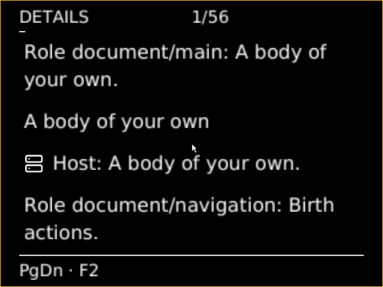

# Actual wide native Details at 200% in two Looks

Source `8b9f820f9779e868770cb26ebfe1ffdb1400a179` passes the supported
`creche-controls-proof --scenario accessibility-details --viewport 1280x800`
with a normal product/guest build, exit 0, unchanged Source and a clean tree.
Host proof-tool glue uses the recorded xtask package opt-level=0 iteration build.

## What is observed

The ordinary focus receipt now includes `showing_details`, read directly from
the current scene beside its current acknowledged Show and measured frame.
There is no new application state, command or renderer reconstruction.
The separate scenario requires explicit F2 entry, every forward/reverse keyboard
observation and every page observation to remain in Details, then explicit F2
return. Navigation preserves the complete Face and acknowledged Show.

The exact long Unicode name is typed through HID and checked once by the Source.
Editorial/compact/Phosphor and Engineering/spacious/paper are both observed at
200% user text minimum with forced colors. Each has all sixteen available typed
controls in complete forward/reverse cycles with equal exact cyclic order.
Every Details page is visited: nineteen Editorial and twenty-three Engineering.
First/middle/last original PNGs are retained, not screenshots of every page.
Seven Look/user constraint replacements retain complete Face and checked
component/recipe/layout with fresh local Shows and no fallback. Clearing user
constraints reveals the requested spacious 125%. No Body is born.

The run has 207 focus records inside the unchanged 256-record bound, eleven PNGs
inside 27, command high-water 48 inside 48 and maximum payload 192 inside 192.
Exact Source/image/build/Boot/Show custody, raw serial/QMP/profile/capture context
and full receipt are indexed in `inventory-wide/summary.json`, with lossless
archives and SHA256 for each raw/archive/PNG. Local archive/PNG hashes verified.

## Initial failed inventory expectation

Source `7e45c4d261acf724206e8649889741b4cca8ff2c` failed the strict inventory
check after actual Details entry. `wide/` retains its exit 1, failure capture,
original logs and exact image/build identity. It is not a successful receipt.
The initial probe expected the twelve primary controls: primary Boolean choices
combine action/argument into one reversible checkbox. Details deliberately shows
their exact typed arguments separately, giving sixteen available controls.
The correction derives every available action and argument from the complete
Face, retains existing contract/availability validation, and still requires the
exact inventory and closed cycles. No product control was removed or invented.

## Remaining scope

This is actual wide Details keyboard/page correspondence, not narrow Details,
every unavailable/refused control or missing-resource fallback. No Details pointer
claim is made; primary pointer proof remains source-specific separate evidence.
Rendered wording reconstruction is covered by earlier CPU cases, not inferred
from focus receipts or OCR. The full Body/Patchbay/Stop journey, physical/human
acceptance, integration and publication remain open. No CI campaign or parent
closure is claimed.

## Narrow Details and shared icons — Source 18f653cf4

Clean Source `18f653cf4eef3f4780413389fee2f4f7a09762ba` now adds the existing
explicit role/intent icon mappings to Details subject and action clauses.
Property values and argument contracts keep text-only presentation. No icon asset,
wording, action, availability or semantic identity changes. Unknown intents keep
text even when their captions resemble familiar actions; read-only views gain no
bindings. All 148 native scene CPU cases pass (one existing opt-in case ignored),
including exact complete Details wording and read-only/unknown-intent checks.
These host tests use the conduitos package opt-level=0 iteration override.

The ordinary two-Look collector's [narrow baseline](narrow-baseline/README.md)
refused its 24-page capture profile after completing keyboard cycles over the
actual 56-page Details view. The new finite one-Look entrances are
`--scenario accessibility-details-editorial` and
`--scenario accessibility-details-engineering`, both with `--viewport 640x480`.
They budget a complete walk against the existing 256 raw focus records before
input, reserving eight records for return/reset headroom. Each physical PageUp
reset is observed from the current page through the clamped first endpoint;
all pages and the clamped last endpoint remain observed. First/middle/last PNG
sampling retains the existing 27-capture limit. The original two-Look wide mode
keeps its existing profile. No product or raw serial/record/command limit rises.

Both new normal-product QEMU runs pass with unchanged Source and clean trees:

| Run | Details pages | Available typed controls | Focus records | Original PNGs |
| --- | ---: | ---: | ---: | ---: |
| Editorial / compact / Phosphor / 200% / forced colors | 56 | 16 | 184 | 8 |
| Engineering / spacious / paper / 200% / forced colors | 71 | 16 | 212 | 8 |

Each verifies complete forward/reverse cycles, exact long Unicode draft, explicit
Details entry/return, every page and checked complete Face/Show stability during
navigation. The exact cyclic keyboard orders also compare equal across these
separate Boots. Face preservation across Look/constraint selection is checked
within each run, not asserted as identity between independent Boots. Clearing
user constraints restores compact 100% or the requested spacious 125% respectively.
Command high-water is 20 under 48; maximum command payload is 192 under 192.
All original PNG/archive/raw hashes were verified. `icons-editorial/` and
`icons-engineering/` retain full receipts, build/image bindings and capture context.

This supersedes the pending narrow Details keyboard/page scope for this Source.
It does not establish Details pointer behavior, every unavailable/refused control,
missing-resource fallback, the full Body/Patchbay/Stop journey, physical/human
evidence or integration/publication. Earlier wide proof remains bound to its own
Source; it is not relabeled current-source pixel proof.
