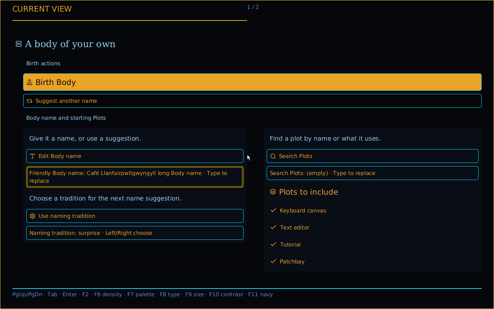
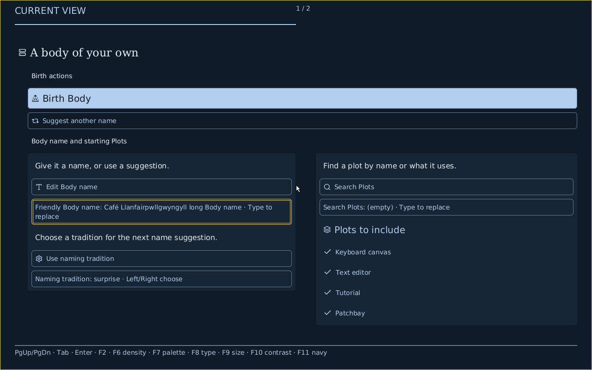

# Actual native navy Look options

Clean Source `235297c3f003790da6e8bea4cab913d5409ee61a` passes normal-product
QEMU `creche-controls-proof --scenario navy` at 1280×800 and 640×480. Both
exit 0 with unchanged Source and clean trees. These are actual QMP captures.

## Appearance and authority

F11 selects a complete navy Look resource through reviewed Source roots. F6 and
F8 retain navy across compact/spacious density and Editorial/Engineering type.
F7 selects the ordinary paper/dark families. F9/F10 keep the navy resource while
applying existing user text minimum and forced-color requirements. F11 again
selects the ordinary dark Look, retaining density/type. There is no parallel CSS,
renderer state or new semantic palette variant. Navy uses the existing dark
fallback family with its own explicit canonical tokens and four distinct Look
identities. The selected complete Look, not the fallback family label, owns paint.
The Source resources reuse the exact same component, recipe and layout.

The palette uses blue-black backgrounds, blue-gray surfaces, pale text/actions,
quieter borders and gold focus. The filled primary action keeps readable dark
text over pale emphasis. The native title can remain serif or use the existing
Engineering Sans resource. Fonts/icons and product resource limits are unchanged.

| Same complete Face, Phosphor restored | Navy, Editorial compact |
| --- | --- |
|  |  |

## Evidence

Each run types the exact long Unicode name through HID, then checks ten actual
preference transitions. All four navy density/type combinations, 200% minimum,
forced colors, constraint clearing and Phosphor restoration retain the complete
Face and checked structure, fresh local Show chains and no component or visual
fallback. Each navy transition also matches the selected Look's exact canonical
byte length and SHA256 to the canonical resource builder. This includes override
states: user constraints do not rewrite Look bytes. No Body is born and the only
Source change is the checked name replacement.

Each run retains ten PNGs inside 27 and 54 focus observations inside 256. Command
high-water is 48 wide / 20 narrow inside 48; maximum payload is 109 bytes inside
192. Per-width summaries index exact Source/Root/ISO/build identity, raw/archive
and PNG hashes. Full receipts and serial/QMP/profile/capture context are lossless
gzip archives. All retained archive/raw/PNG hashes were verified locally.

Local checks pass: eight navy Source/Host combinations over both structures,
densities and type choices equal the complete canonical resources; the existing
typography Source case also passes. The native preference test now exercises
25 replacements and exact current-Show draft submission. Native semantic paint
checks enforce text contrast ≥4.5 and focus/border contrast ≥3 in both pixel channel
orders, with forced-color precedence. Canonical Look round-trip/size/contrast
checks include navy. Native functional tests use the conduitos host-package
opt-level=0 iteration override; host proof-tool glue uses its recorded opt-level=0
build. Normal product/guest profiles remain unchanged.

## Remaining scope

This establishes the navy color direction and four local Crèche Look choices,
not exact reference pixel parity. Full native token-metric/radius enactment and
reference depth remain separate gaps. The owner-acknowledged component picker does not yet offer navy;
[the later Patchbay application picker follow-up](../gui-look-6349-browser-navy/README.md)
retains its own browser Source and scope.
These captures do not prove Todo/Patchbay reuse, every control/page under navy,
unavailable/resource cases, full Body/Patchbay/Stop, physical/human evidence or
integration/publication. No CI campaign or parent closure is claimed. Earlier
negative evidence and the known later Application WorkExhausted remain retained.
