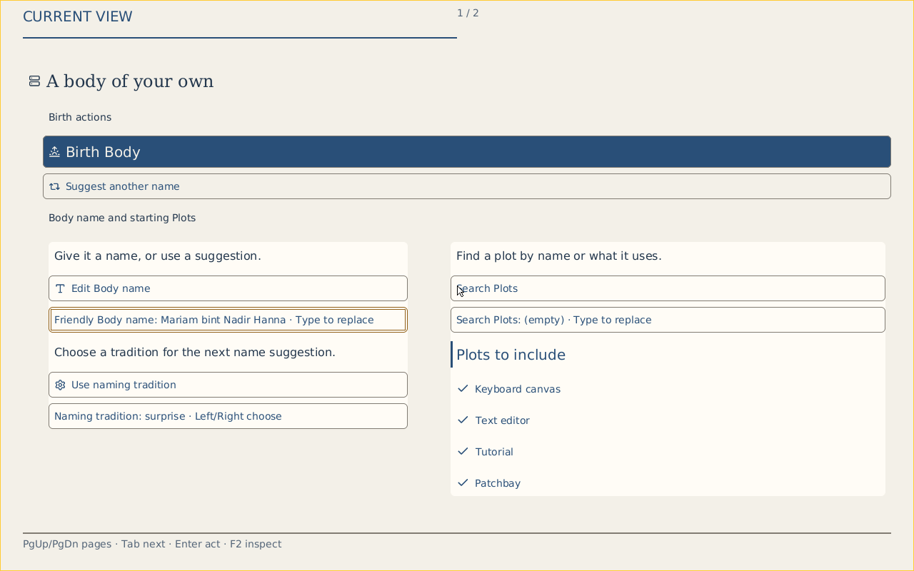

# GUI Looks and Lucide delivery (#6349)

Draft implementation and local visual review for #6349, with the original
#6174 and #5366 acceptance preserved. All three issues remain open.

The earlier refinement captures below use Source `2ab838ae2`. Native Crèche now
has checked outer margins, cohesive naming/Plot panels, explicit action icons,
serif hierarchy, clear primary/focus treatment and compact/spacious expression.
Browser Workspace offers Editorial, Engineering and Phosphor chrome choices;
Patchbay and the reusable Face renderer use the same pinned Lucide corpus.

## Current screenshots and source evidence

[Native dark navy](evidence/gui-look-6349-refinement/native-polished-creche-default.png) ·
[Native spacious Editorial](evidence/gui-look-6349-refinement/native-polished-creche-editorial-spacious.png) ·
[Browser Editorial](evidence/gui-look-6349-refinement/workspace-current-editorial.png) ·
[Browser Engineering](evidence/gui-look-6349-refinement/workspace-current-engineering.png) ·
[Browser Phosphor](evidence/gui-look-6349-refinement/workspace-current-phosphor.png)

The [refinement evidence directory](evidence/gui-look-6349-refinement/) retains
raw native serial records, exact image/source/Host receipts, Show correspondence,
browser resource hashes, interaction results and accessibility scan results.
The [earlier native capture](evidence/gui-look-6349-native/) preserves the flat
baseline at native Source `749491a3c`; its later branch changes were browser-only.

Native capture boots the normal x86_64 product, enters Crèche from zero-Body
Commons through the real keyboard path, then selects palette and density in the
same guest. Complete serial records confirm the unchanged Face identity/revision
and distinct chained local Shows. Compact Editorial uses 47/48 commands and keeps
all four selected Plots visible on page one; spacious admits three pages at its
selected 125% text scale. This is freestanding QEMU presentation, not physical
or CI/stable acceptance.

Browser capture uses the fresh release WASM, all 90 current package resources
and regenerated reviewed Plot bundles. Standalone provisioning release artifacts
are retained, separately identified dependencies; these captures do not establish
fresh device provisioning. Early chat previews used retained WASM or sample data;
the current browser screenshots replace those as current-runtime evidence.

## Implementation and validation

- The shared role/intent vocabulary generates browser decoration and native
  mappings for 28 pinned Lucide silhouettes, including distinct search, inspection,
  Lull, library and collection symbols. Existing wire tokens retain their meaning.
  The 129024-byte read-only mask corpus reproduces exactly with input/output
  hashes and the pinned Chromium version. No runtime SVG parser or asset loading.
- Generated browser/ISO packages carry the Lucide notice; both browser application
  templates admit the icon helper explicitly. Collection typography follows its
  selected type intent independently of palette.
- Exact owner-offered intents select common action icons. Unknown intents retain
  complete text; captions and opaque action IDs never select artwork. Native
  defaults, unavailable controls, and missing-Look behavior retain their contracts.
- Native group surfaces follow explicit checked recipe groups. Fixed storage holds
  at most 20 page rows. A surface replaces the group's divider budget; icon-bearing
  headings avoid redundant accent bars. No command/payload limit was widened.
- The checked Crèche Source owns its two-em outer inset. Geometry, text wrapping,
  hit bounds and continuation are prepared together; Face/action order is unchanged.
- Browser controls retain labels and native focus/input behavior. Checklist buttons
  use concise visible action captions and item-specific accessible names. Palette
  text/background changes are atomic to avoid transient contrast failures.
- Patchbay SVGs are inline under the unchanged image policy. Library/Inspect
  keyboard activation remains usable, with no CSP image error.
- 138 native scene tests pass; the separately executed opt-in CPU cross-Mask
  graph check also passes with Node (not real-browser proof). The wide first-page
  and surface bounds/content checks pass. Native lookup, exact-intent and paint contrast checks
  also pass. 103 browser renderer checks pass, one worker and zero retries.
- Fresh browser Birth, name retention across three Looks, and 1440px/390px layouts
  pass. All three 390px axe scans report zero WCAG A/AA violations. Automated scans
  do not replace complete keyboard, screen-reader and native accessibility proof.

An initial icon/inset attempt failed the existing four-selected-Plots-on-first-page
check. The requirement was preserved and repaired through cue budgeting. The
properties-in-Details check retains exact disclosure and now checks the Document
icon instead of its deliberately removed, redundant three-pixel accent bar.

## Remaining acceptance

| Area | Work still required |
| --- | --- |
| GUI coverage | Audit remaining native actions, graph/inspector/list/status surfaces and unsupported icon fallbacks; retain meaningful text. |
| Native reference #6174 | Further inset/typographic refinement, narrow/large-text and pointer enactment against the actual reference; record supported differences. |
| Look parent #5366 | Reuse closed #5627/#5628/#5629 foundations; verify full original cross-component, cross-renderer, accessibility and selection acceptance. Local Workspace chrome choices alone are not canonical resident-Face selection proof. |
| Browser/native correspondence | Preserve exact selected Face/Show/action identities; independent bodies or fixture previews do not prove one shared Body. |
| Publication and closure | Draft checkpoints skip CI. Required final acceptance/publication evidence remains separate; no issue closure claim. |

Environment stewardship removed about 22 GB of inactive, regenerable native-origin
Cargo build-script outputs after process/fd inspection. Source, retained runtime/
server binaries, proof captures and active builds were preserved. The earlier
80 MiB native ISO is retained locally before replacement by the refinement build.

The shared-vocabulary checkpoint follows the captured Source above; those native
and browser product screenshots retain their original source identity. Its local
renderer/packaging checks are recorded separately; new native boot/publication
evidence is still required. A sample-data three-Look comparison demonstrates the
current shared renderer and does not establish shared-Body correspondence.

Shared-vocabulary validation: 138 native scene checks pass (one opt-in ignored),
including the unchanged four-Plot first-page requirement. All 104 Chromium
renderer checks pass with one worker and zero retries. SDK packaging plus two
vocabulary checks pass; all 28 coverage masks are finite/nonempty, native paint
contrast checks pass, and generated mappings/raster provenance reproduce exactly.
The initial SDK/native failures were `/tmp` quota exhaustion; logs were retained
and the checks passed with workspace-local temporary storage. This checkpoint
reclaimed about 18 GB of unowned incremental outputs after process/map/fd audit;
active builds, source and unique evidence were preserved.

## Packaged-runtime follow-up

The latest normal-product native image at `dd5349718` boots and presents the
shared search/collection vocabulary. Compact Editorial uses 48/48 commands with
all four selected Plots on the first page; spacious uses 25/48. The unchanged
Face revision and fresh chained local Shows are recorded in the new captures.

Fresh packaged-browser execution caught a dependency import quoting mismatch
missed by direct renderer checks. The import now follows the sealed loader
contract. Birth and Look switching work with all 92 admitted resources. The
invitation receiver gains shared Body/Inspect icons and readable 44px fields.
Grid minima and choice widths now allow narrow/large-text wrapping; no content
is hidden or clipped. The actual packaged app is checked at 1440/390/320 widths,
plus 32px/64px text with forced colors and keyboard invalid-input refusal.

The [surface inventory](gui-surface-inventory-6349.md) identifies remaining
ordinary-GUI coverage gaps and explicit fallbacks. Full resident-Mask Look
selection, native pointer/large-text enactment and original parent acceptance
remain outstanding.

The [packaged evidence](evidence/gui-look-6349-packaged/) now retains the wide
QEMU captures, complete serial prefixes, source/Show receipts, final browser
captures and checks, and the actual 640×480 control proof at `fefbc1402`. The
narrow proof passes with 12 reachable controls, forward/reverse traversal, long
Unicode name changes/restoration, pointer focus/naming, incomplete-argument
refusal, 4 primary pages and 22 Details pages. Its 17 actual screenshots sample
first/middle/last pages; unsampled pages have focus receipts, not pixel claims.
Physical/human evidence and full fallback acceptance remain explicitly false.
The first attempt failed the Unix socket pathname limit; a short alias to the
same workspace temporary directory allowed the unmodified proof to pass.

[Reference comparison and remaining visual differences](creche-reference-comparison-6174.md)
separates meaningful source differences from remaining paint/layout work.

## Native checked card insets

Mechanical rows now retain the padding reserved by single-region checked
ancestor groups. Cohesive card paint includes that already allocated space,
so fields no longer meet the card edge. Text measurement, hit bounds, semantic
order, page cuts and command costs are unchanged. A mixed root is inspected
across every fragment; one homogeneous continuation page cannot accidentally
turn the root into an enclosing card. Existing unstructured/configured rows
retain zero additional region inset. The surface check now requires the full
checked inset around every first-page card row, alongside the unchanged
four-selected-Plots and 48-command requirements. Fresh normal-product QEMU captures at `6034b2c17` are retained in
[evidence](evidence/gui-look-6349-inset/). All 138 native scene checks pass
(one opt-in ignored); the current 640×480 control proof passes. All 13 stable
long-name focus/hit/page samples equal the earlier `fefbc1402` proof. Compact
retains all four Plots at 48/48 commands; spacious stays at 25/48. Face revision
and chained local Show acknowledgement remain unchanged across Look switches.

## Native graph symbols

Patchbay diagram cards reuse the shared Gear/Lucide symbol alongside their
ordinal and readable name. The measured title box reserves the icon inset;
complete labels remain in Details. Decoration is admitted for all visible cards
or none, using only commands left after the existing cards, Port rows, overflow
notices and visible Cord prefix. No connection is displaced to make room for
artwork. Small/dense pages retain complete labeled cards and the same graph
geometry, hit targets, semantic subjects and omission reporting.

Focused rendering checks cover the ordinary graph with three Gear symbols and
its two original Cords, and a saturated six-card/24-Port graph that fills the
48-command budget and correctly retains text-only cards. Existing exact endpoint,
fan-graph, ambiguity and large-graph checks pass. At Source `d2e7caeb2`, all 140 native scene checks pass (one opt-in ignored).
The actual normal-product journey reaches Patchbay, Gear Details, diagram return
and Stop on the same Body. Its four Gear symbols and original three Cords are
visible in [27 source-bound captures and receipts](evidence/gui-look-6349-graph/).
The 48-command bound is unchanged.

The supported graphical-profile command also starts headless asset-closure
builds for four other architectures. That additional build portion was deliberately
stopped after the completed native journey/compositor collection; exit 143 is
retained. This is not full graphical-profile or cross-architecture acceptance.
Inherited capture names containing engineering denote Phosphor palette changes,
not proof of Engineering typography. About 8 GB of verified inactive task-owned
incremental cache was removed; compiled libraries, media, evidence, active and
other-task builds were preserved.

## Owner-facing browser Look controls

The owner Handbook now separates Density and Palette proposals over the four
existing checked presets. Browser wire decoding and installed-owner conversion
accept those same finite names; arbitrary CSS/Look objects still refuse. A
small controls module replaces inline orchestration and uses the existing
select/prepare/acknowledge route. Pending, offline and speech-held encounters
disable the selectors. Rendered state still comes from the acknowledged Show.

The browser Mask reports the prepared recipe identity explicitly. The controls
retain a recognized current recipe when only appearance changes; foreign or
unavailable recipes require an explicit layout choice. No geometry/name-based
recipe guessing or second Face store is introduced. Minimum text size remains
a hard user constraint. Typography is supplied by the selected preset and is
reported in the Shown status; separate typography selection remains outstanding.

Wire checks preserve exact Show integers across all four presets. The 140
registered Chromium renderer, reachability, sealed-module and controls checks
pass with one worker/zero retries, including narrow/forced-color controls. The Rust closed
transport mapping check passes. A fresh runtime/installed-owner encounter is
recorded separately; fixture controls do not establish owner acknowledgement.

The first focused browser invocation ran 137 existing checks but omitted the new
controls file because the shared config uses an explicit test allowlist. The
file is now registered. Live UI inspection also exposed select option text in
wrapped-label names; explicit native label/for associations fix that. The new
forced-color check exposed undefined-theme focus styling, now backed by native
system colors. Negative setup/test results are retained beside final results.

Real installed-owner proof at `89c463ea2` now passes all four density/palette
combinations after three real Todo adds. The canonical Face and exact decimal
revision stay unchanged; grouped recipe and Body stay fixed; fresh Shows are
acknowledged. Retired-Show interaction refuses with `StaleShow`. Forced colors
with a 200% text constraint at 390px has no document horizontal overflow.
The driver exits zero with no browser errors. See
[evidence](evidence/gui-look-6349-owner-controls/README.md). This establishes
local Linux-owner/browser selection only; native, physical, human and broad
cross-component acceptance remain outstanding. Private disposable owner state
is excluded from evidence.

## Owner chrome coverage

At `589a38bcb`, owner participation headings, join/refresh/inspection, wardrobe
policy, playback/status/stop and leave controls consume the existing shared
Lucide helper. Fixed local operation mappings stay separate from offered Face
intents. Labels, disabled policy and callbacks remain unchanged. Native button
and input targets have 44px minima, visible focus and narrow wrapping; identity
facts stack at narrow widths. Public-key copy retains its explicit text rather
than borrowing an unrelated glyph. The 140 registered browser checks and owner
participation/collection unit checks pass; actual owner captures are separate.

Real owner rerun at `589a38bcb` passes with all visible buttons at least 44px
tall. [Owner chrome captures and receipts](evidence/gui-look-6349-owner-chrome/README.md)
include wide and narrow forced-color wardrobe/reading panels. Audio playback is
not exercised. Reading's initial join instruction remains stale after joining;
wardrobe text can describe the last inspected revision rather than current Show.
These observed wording gaps remain explicit.

## Patchbay inspection and owner status wording

At `774b753b4`, Patchbay Cancel placement, facts disclosures, workspace/deep
inspection, linear toggle and Plan/Play/route/Host/diagnostic headings use the
existing pinned Lucide sources. Shared CSS owns decorative stroke/fill styling;
new inline SVG keeps finite 18px dimensions without styles. Source HTML remains
23,974 bytes, below the existing 24,000-character furniture check. No admitted
resource or graphics bound was widened. Labels, slots, callbacks and semantic
order remain unchanged. This is chrome coverage, not canonical Patchbay Look
selection or owner/native correspondence.

The owner reading panel's idle text now says no reading was requested in this
window. Wardrobe status explicitly describes its last inspected revision and
what was reported at that time; it asks for a new inspection for current policy.
This resolves the observed misleading present-tense wording without guessing
policy from a newer local Show or discarding actual refusal reports.

Real installed-owner rerun at `774b753b4` asserts the corrected status text and
passes the existing four-Look/identity/stale-Show/narrow constraints again. The
new inspection capture exposed missing bottom-dock CSS and forced two-column
evidence inside narrow drawers. CSS at `ed65db495` implements bottom docking
and reflows cards against their actual container width. Three furniture tests
pass, including new right/bottom bounds and narrow forced-color containment;
four authoring/render checks and nine owner checks pass. The documentary
Patchbay typed linear action succeeds, with no browser errors or document
overflow. [Captures and source-specific receipts](evidence/gui-look-6349-inspection/README.md)
retain the initial panel-closed capture failure and final positive results.
This is not canonical owner Patchbay Look selection or native/CI acceptance.

Task-owned inactive incremental cache was audited against active crate names,
process maps, open files and working directories before removal. About 5GB of
allocated regenerable cache was removed across two passes; actual available
space reached about 10GB after the build completed. Active directories, compiled
libraries/binaries, private owner state and all other tasks were preserved.

## Inspector occlusion and enlarged text

Visual review led to a failing real hit-test: floating Workspace controls sat
above the bottom inspector. At `a8faf68c4`, drawers are layered above local tools
and furniture/status actions have 44px minima with larger text/padding. Source
`7dda0f703` additionally lets narrow wrapped furniture scroll with evidence,
avoiding sticky-header occlusion. Four furniture checks pass, including all
three controls' viewport bounds, dimensions and pointer reachability at 390px,
32px root text and forced colors; scrolling exposes an evidence heading, and
closing restores the underlying tools. The documentary typed linear action
continues to succeed. [Positive and negative evidence](evidence/gui-look-6349-inspector-accessibility/README.md).

This focused drawer check is not full zoom or whole-shell accessibility proof.
The enlarged capture shows masthead/navigation crowding outside the drawer;
that remains an explicit next surface gap. No native or CI proof is added.

## Narrow masthead and canvas action reachability

Source `cba55f945` makes Patchbay's narrow masthead follow existing source order,
wraps product navigation before status, and retains 44px link targets. One
observer measures three existing bands in dependency order, replacing fixed
vertical offsets while retaining bounded native scrolling. Actual Fit activation
exposed flex shrinking that clipped canvas controls; groups now retain content
height. Five furniture checks pass, including Fit at 390px / 32px text / forced
colors. Captures at 1440px, 390px ordinary text and 390/320px enlarged forced-color
text retain initial and explicit Fit states, without document overflow, header
band overlap or browser errors. [Evidence and failures](evidence/gui-look-6349-masthead/README.md).
Full browser zoom, cross-component Look and native acceptance remain separate.

## Ordinary Workspace activity strip

At `72df3b659`, Plot/flow/lifecycle inspection uses pinned labeled symbols and
44px targets. Dynamic selection updates retain a separate label span, preserving
the Plot icon. Fresh supported staging regenerates the initial Body and reviewed
catalog and admits all 92 resources. A real browser Body is birthed and awakened;
Memory Lantern receives authoritative Unicode text. Three local chrome Looks,
three keyboard inspection/focus-return round trips and 390px / 32px forced-color
text retain the same Body/Plan/active Play and editor value. Both existing
Birth/Wake/reload and narrow listening journey checks pass. [Captures and receipts](evidence/gui-look-6349-workspace-activity/README.md).
These are chrome preferences, not canonical resident Mask Look selection. Editor
font/surface integration and cross-renderer acceptance remain broader Look work.

About 1.9GiB of actual disk space was recovered from verified inactive task-owned
incremental cache after staging. Active process maps/open files/crate ownership
were inventoried; compiled libraries/binaries, source and evidence were preserved.

## Native graph width and Port symbols

Source `a161ac474` removes the native diagram's 320px card-width cap, using the
available admitted viewport width for its existing two-column structure. Port
symbols reuse the existing Plug mask and consume only residual commands. A
measured all-or-none check refuses decoration if any prepared label would be
shortened. The 48-command ceiling, complete mandatory prefix, source subjects
and action identities remain unchanged; hit regions and Cord endpoints follow
the shared wider geometry. The initial narrow positive fixture correctly falls
back; the corrected wide check and dense 24-Port fallback pass. Full native
scene checks pass: 144, with one opt-in ignored.

The fresh normal QEMU journey completes at that Source with 27 verified PNGs.
The visible graph has 4 Gear/7 Port symbols, 3/3 Cords shown and zero omitted.
[Source-bound captures, canonical Face and raw archives](evidence/gui-look-6349-native-ports/README.md)
retain the positive journey and a material negative result: the subsequent
compositor-custody collector refuses `embedded compositor ELF: Ambiguous`, so
the full graphical-profile command exits 1. No headless asset tail starts and
no success is claimed for artifact custody, CI, native accessibility, physical
or publication acceptance. Existing compositor ownership (#6365/#6369) remains
separate; neither is assumed to fix this exact refusal.

Prior native image/proof trees and the newly built ISO are preserved in task
storage. Two process/map/open-file audits reclaimed roughly 7GiB of inactive
incremental cache while preserving compiled libraries, active builds, artifacts
and other tasks.

## Shared named typography policy

Source `350be7db7` corrects a preset mismatch: Todo's `compact` expression used
Engineering typography while Crèche and canonical Phosphor used Editorial.
Five Todo literals now match that existing policy; all other appearance fields,
recipes and preset names remain unchanged. Prepared checked roots prove exact
policy equality across Todo/Crèche and unchanged Fore/recipe/layout per component
across four selections, including retained component roots. Thirty-five focused
contract checks and the native maximum-Todo profile check pass.

A fresh installed Linux owner/browser run adds three real Todo items, then
acknowledges all four selections with Editorial policy and computed serif intent.
The component reference, recipe, layout, full canonical Face/revision and Body
stay fixed. Retired-Show refusal and 390px / 200% forced-color checks pass, without
browser errors. [Screenshots, canonical reports and regression failure](evidence/gui-look-6349-shared-policy/README.md).
This is a correction atop accepted #5627/#5628/#5629, not closure of #5366:
the owner selection API remains Todo-specific and checked Patchbay reuse is
still missing. No new current-source native QEMU, full accessibility or CI
acceptance is claimed. Roughly 2.3GiB of verified inactive incremental cache
was reclaimed before the fresh builds; active artifacts and evidence remain.

## Focus-owned Patchbay Escape

Source `4afc3a901` fixes dismissal when Body inspection coexists with Library:
Escape now closes the focused surface and returns focus to its own launcher.
The actual UI regression fails on the preceding executable; all six furniture
checks pass after a fresh build (one Chromium worker, no retries). Enlarged,
narrow and forced-color checks remain included. [Evidence and screenshot](evidence/gui-look-6349-escape-focus/README.md).
This is documentary-fixture browser accessibility evidence. Checked graph Look
selection and whole-GUI/native acceptance remain incomplete. An audited cleanup
reclaimed 3,006,279,680 bytes of inactive task-owned incremental cache, preserving
compiled libraries, source, active work and unique artifacts.

## Realized canonical browser typography and graph clearance

Source `e3afcff9b` fixes an admitted-but-unrealized typography choice in the
shared browser host and exports all canonical Patchbay surface roles. Look
scope clears correctly, action identity/name remains intact, and the graph
viewport now reserves measured navigation height at desktop widths. Two scoped
Look checks, eight wire checks, one server check and seven furniture checks pass;
a focused stronger Fit check additionally proves all five nodes are in bounds.
[Current screenshot and evidence](evidence/gui-look-6349-css-intent/README.md).
Canonical Face remains equal across the actual presentation navigation. This
is documentary-fixture browser proof; checked graph component selection,
current native enactment and original parent acceptance remain open.

## Measured status footer and clear graph

Source `a74afe3f5` moves current truth, observation, run and workspace furniture
into a bounded native-scroll footer and reserves its actual height in the graph.
The omitted-Cord notice uses the same React tree with an explicit footer target,
retaining exact wording/status and a fallback for other Flow consumers. Desktop
navigation uses available width. All 12 HTML/furniture checks pass on a fresh
local executable; exact semantic identities and interactions remain checked.
[Current wide/narrow screenshots and receipts](evidence/gui-look-6349-status-footer/README.md).
The broader authoring run with an explicit existing sealed runtime still fails
both scenarios (zero initial Gear nodes; selection inside hidden inspector).
Those failures are retained without attributing a cause or claiming acceptance.
No CI or native acceptance is added by this browser slice.

## Actual catalog capacity and serialized workspace actions

Source `7e16ac058` fixes two concrete failures uncovered by real authoring:
82 admitted Kinds exceeded the Library's 80-entry pool (now aligned with the
existing 128 transport ceiling), and overlapping workspace operations lost a
named layout. Pending workspace actions now serialize with aria-busy and exact
availability restoration. Thirteen focused browser checks, three contracts and
the full simple author/save/Birth/Wake/Plan/Play scenario pass. The unbodied
workspace variant preserves exact Face and Source through both layouts and
reload. [Screenshot, root-cause evidence and proof boundaries](evidence/gui-look-6349-authoring/README.md).
The complex nine-Gear lifecycle variant remains negative at Play delivery with
ERR_EMPTY_RESPONSE; the full authoring suite is not accepted. Native and checked
cross-component Look acceptance are still open. Draft checkpoints continue to
skip CI.

## Readable configuration and real minimum text size

Source `c1e9fe399` corrects the plot-field styling mismatch, adds readable exact
requirements/native rule disclosures and input help/refusal associations, and
reuses pinned Confirm glyphs on Apply/Place with the complete license embedded
in the generated module. A computed check caught 16px inputs under a 32px root;
the shared stylesheet now respects the actual root/user minimum. The 390px
forced-color capture verifies 32px input text, fitted controls and reachable Apply.
The sticky inspector padding strip is covered. Startup fitting no longer races
saved viewport restoration; that existing check passes three times in succession.
[Captures, positive checks and retained failures](evidence/gui-look-6349-fields/README.md).
The final 15-test GUI run has 14 passes and the still-open complex Play delivery
failure. Two scoped Look checks, seven contracts/vocabulary checks and two exact
package checks pass separately. Native, cross-component Look and full parent
acceptance remain open; no CI campaign was started. Audited inactive incremental
caches recovered 2,404,630,528 bytes while preserving source and unique evidence.

## Quantity Play diagnosis

The complex Play delivery failure is now reproduced independently with a four-Gear
Quantity Source. The server exits 101 on `ready math output: OutputBlocked`; Open,
Birth, Wake and Plan succeed against actual current Face actions. Focused runtime
prerequisite [#6387](https://github.com/dancxjo/conduit/issues/6387) retains both
checked queue-bound and temporary completion-pressure acceptance.
[Minimal Source, exact requests and negative receipts](evidence/gui-look-6349-quantity-play/README.md).
The browser proof now attaches server stderr on failure. No production runtime
fix, full-suite pass or parent completion is claimed.

## Owner Face browser text preference

Owner component fonts now use root-relative units, preserving default sizing
while composing browser text preferences with admitted minimum text scaling.
The regression first failed with an unchanged 13px button; final checks prove
26px at a 200% browser root and 52px with the additional 200% admitted scale,
without horizontal overflow at 390px. All 141 owner renderer/reachability/Look
checks pass. [Source-bound receipt and 400% forced-color capture](evidence/gui-look-6349-owner-root-text/README.md).
This is browser renderer evidence; full native and cross-component acceptance
remain open.

## Readable native browser writing surfaces

Memory Lantern's textarea inherited the signal readout's 56px monospace type.
Shared text/surface tokens now give writing a readable 16px default and honor
the browser root minimum, with platform forced colors and a bounded measure.
Workspace picker/review fonts and heading clamps now honor root text preference.
Actual Birth/Wake and Unicode edits preserve editor/revision/selection and
Body/Plan/Play across three chrome preferences. Narrow 390px/32px checks pass,
including another authoritative edit; five editor contract tests and Look wire
checks pass. [Screenshots and exact asset/runtime provenance](evidence/gui-look-6349-writing/README.md).
This is not canonical cross-component Look selection or current native acceptance.

## Dynamic graph Lucide geometry

Patchbay node tokens now resolve through the shared pinned geometry and canonical
wire-token map, with Port/status decoration and original text fallback for unknown
tokens. Fourteen graph/HTML/furniture and eleven vocabulary/Look checks pass; the
final two-check proof changes Gear selection by keyboard and Port selection by
pointer, preserving exact server navigation and the Face through narrow reflow.
[Source-bound captures, negative transition evidence and limits](evidence/gui-look-6349-dynamic-icons/README.md).
The workbench capture is documentary-fixture browser evidence. Direct keyboard
Port selection, canonical cross-component Looks and native acceptance remain open.

## Native-button Port selection in browser Patchbay

The direct keyboard Port gap is repaired: labeled native buttons share the exact
selection handler with pointer input, retain separate connection handles and
expose server-derived pressed state. Tab entry, Enter/Space and exactly one
request per activation are verified. All fourteen graph/HTML/inspection checks
pass. [Current captures, source and proof boundaries](evidence/gui-look-6349-port-keyboard/README.md).
Canvas zoom scales target geometry; 44 CSS-pixel minima are not a claim of 44
physical pixels at every Fit scale. Native, Quantity runtime and canonical
cross-component Look acceptance remain open.

## Live Quantity authoring path succeeds locally

The combined local proof with runtime draft #6393 now passes all seventeen
authoring/HTML/graph/inspection checks in one Chromium run, one worker and no
retries. The original four-Gear HTTP path also succeeds through Open/Birth/Wake/
Plan/Play, with no server stderr. The nine-Gear browser scenario retains actual
Source/Gear and Plan/Play identity through two saved layouts and view changes.
Both Sign properties and transcript lines now continue losslessly within the
existing Face field bound; reviewed palette/offer Fore construction agrees.
The Body overview header keeps its symbol and no longer claims No Body when the
Face supplies an existing Body.
[Actual live screenshot, exact Face receipt, hashes, positive and negative logs](evidence/gui-look-6349-live-quantity/README.md).
This proves a combined local source, not either isolated PR head, CI/native/
publication acceptance or canonical cross-component Look completion.

## Typed application Look options

[Current screenshots and receipt](evidence/gui-look-6349-typed-options/README.md)
show actual Patchbay rendering of complete Editorial, Engineering and Phosphor
`LookInfo` resources through the existing finite stylesheet/package path.
A keyboard picker changes appearance while retaining the exact Face and graph.
Nine focused Chromium checks pass together, with one worker and zero retries;
ten Look/admission checks, two exhaustive package checks and the HTTP theme
check pass. Actual 32px text at 390px exposed and now verifies a focus/scroll
repair across changing typography. Earlier negative logs remain beside success.

This is documentary-graph browser application proof. The component startup
migration is implemented below; live transport and current native enactment
remain separate acceptance boundaries.

## Complete configured Looks: local checks and live transport refusal

Configured component contracts @4/@5 now carry the complete typed Look rather
than an expression-only startup parameter. Todo and Crèche retain matching
canonical preset bytes. Browser rendering lowers the selected Look tokens;
native rasterization retains the complete Look, applies token paint with
accessibility precedence, and invalidates retained pixels on token changes.
Eleven source/planning checks, ten native offer checks, 177 native Face checks
(one opt-in ignored), twenty compositor checks (two opt-in ignored), and 142
Chromium renderer/reachability/control checks pass. Four further appearance
proposal checks verify that unchanged Face refreshes preserve unfinished choices.
The protected x86_64 renderer compiles; this is not current QEMU execution.
The supported optimized browser runtime is 15,973,212 bytes, within the unchanged
20 MiB delivery ceiling.

The fresh installed-owner/browser encounter refuses the complete configured
route: `SealEncodingCapacityExceeded { bytes: 73764, maximum: 40960 }`.
The owner response ceiling is independently 60 KiB and the reviewed browser
WebSocket payload is 64 KiB. Raising only the seal bound cannot complete this
path. No live complete-Look selection or screenshot is claimed. The existing
route and acknowledged-Show submission path are retained after refusal; a
speculative submission queue was reverted. Bounded transport of the full checked
configuration remains required before live acceptance. Private control traces,
credentials and owner state are excluded from published evidence.
