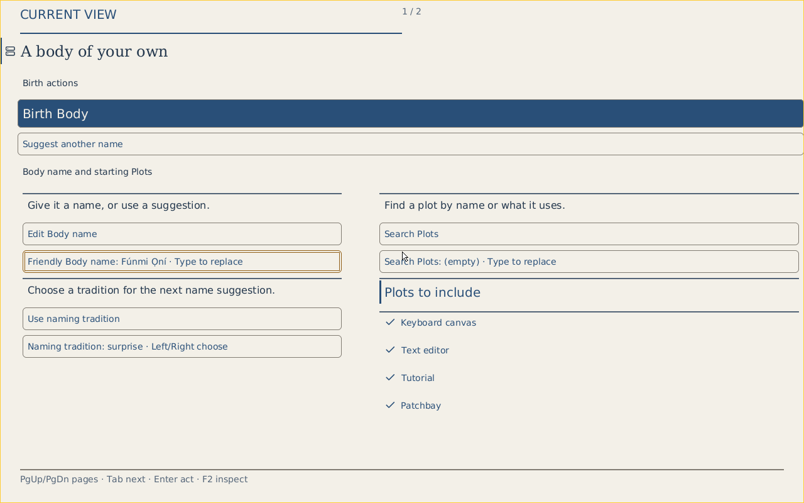

# GUI Look delivery progress (#6349)

First local slice: reusable browser Face headings consume geometry from the
existing pinned Lucide subset. Editorial, engineering and Phosphor expressions
receive a more consistent surface, typography, focus and control rhythm.

Local validation: 102 existing owner-face-component Chromium renderer checks
passed with one worker and zero retries; JavaScript syntax and diff checks pass.
The comparison screenshot is a renderer fixture, not a production Body receipt
or native acceptance. Theme options are currently supplied by existing renderer
expression fields; a production selector and native convergence remain work.

Next: audit actual Crèche/Workspace/Patchbay surfaces and action/icon contracts;
extend pinned icons with provenance; apply shared mappings and selected Looks;
show actual local browser and native captures; verify narrow/large-text/forced
colors and exact typed interactions. Complete original #6174/#5366 requirements
before proposing closure. Keep CI deferred while visual work is under review.

## Workspace / Crèche local continuation

Workspace now exposes an in-session chrome Look picker for editorial,
engineering and Phosphor. This is explicitly local appearance; resident Face
expressions remain under their existing admitted contracts. Crèche gains
large editorial headings, measured wide two-column placement, 44px minimum
choice targets, selected-state borders, readable review output, and pinned
Lucide decoration. Workspace lifecycle, membership and back controls carry
label-preserving Lucide icons. Native icon conversion remains outstanding.

The local application was repackaged with edited browser assets and retained
WASM from `6283-fresh-workspace-product` (23 October). This is mixed-source
local presentation evidence, not exact-source runtime or stable acceptance.
All three Looks at 1440px and 390px had no document horizontal overflow;
changing Looks retained the entered name, and actual Birth reached the Body
surface. Desktop and narrow captures are retained in the chat outputs.

## Native Lucide preparation

All 23 existing native icon keys now map to pinned Lucide silhouettes. Packed
192×192 one-bit masks preserve the existing eighth-pixel lookup and 4×4 coverage
blend, replacing the native approximation drawings. The fixed read-only corpus
is 105984 bytes. Input hashes, Chromium version and output digest are retained;
preparation reproduces masks and receipt exactly with `--check`.

Browser and native subject-role mappings agree for Body, Plot, Host, Gear, Port,
Cord/Line, Plan, Play, Document, Status and Diagnostic. Native Document/Plot
headings now use their existing Type/Face icon keys, with layout insets and
command costs handled by the existing icon-aware layout. This does not assert
that every native action already carries an icon.

The native icon sheet is a preview of these exact prepared coverage masks. It
is not an emulator capture, native Show acknowledgement or containment proof.
A standalone compilation of the actual lookup module passes its finite,
nonempty-coverage and out-of-bounds checks. Full native crate checks and fresh
QEMU captures remain independently required.

## Coverage still to finish

| Surface / requirement | Current local evidence | Remaining work |
| --- | --- | --- |
| Browser Crèche | Three Looks, wide/narrow captures, real Birth with retained WASM | Fresh source runtime; full accessibility audit |
| Workspace chrome | Look picker; lifecycle, membership, back icons | Broader live Body/inspection/library capture |
| Shared browser Face | Role icons; 102 renderer checks before native continuation | Complete action/icon coverage and Look selection convergence |
| Native Face | Prepared Lucide resources and role bindings | Full native checks, actual QEMU before/after |
| Native Crèche reference #6174 | Existing checked layout/Look owners preserved | Actual reference comparison and original acceptance |
| Visual Look parent #5366 | Browser appearance experiments and existing selected native contracts | Original cross-component, cross-renderer and accessibility acceptance |
| Patchbay / Commons | Existing semantic authority unchanged | Inspect real graphical surfaces and apply coherent coverage |
| Release / closure | Draft PR checkpoints skip CI | Defer CI campaign; no issue closure claim |

Native crate validation now passes the packed lookup test and both role/layout
checks. All 102 shared browser renderer checks also pass after role convergence.
The staged Crèche WCAG 2 A/AA and 2.1 AA axe scan reports zero violations at
390px for all three Looks. The scan exposed transient low contrast when text
colors interpolated across Look changes while backgrounds changed immediately;
Workspace now switches those text colors atomically. Disabled controls retain
readable muted text and dashed edges instead of faded opacity. Automated axe
results do not replace keyboard, screen-reader or complete accessibility proof.

## Native Editorial and Patchbay continuation

Native Editorial now resolves warm paper/navy roles, matching the browser Look
intent and Crèche reference rather than retaining the previous unrelated dark
blue palette. The existing actual paint-role contrast tests pass against the
changed implementation (standalone harness): text/status/accent roles at 4.5:1
and controls/focus/borders at 3:1 on both native surfaces, including RGB/BGR and
forced-color/fallback cases. Fresh normal x86_64 live-media build is in progress.

Patchbay chrome adds pinned Lucide icons to Library, Inspect, canvas navigation,
arrangement, contrast, selection clearing and evidence download. SVGs are inline
and decorative, preserving text and native button semantics under the existing
`img-src 'self'` policy. CSS data-image masks were rejected by that real policy
and replaced before publication; the policy is unchanged. Local preview uses
the retained native-origin Patchbay server/runtime with current HTML/CSS,
resealed resource hashes and an unchanged security policy. It is mixed-source
presentation evidence, not exact-source production acceptance. Library/Inspect
keyboard activation remains usable and no CSP image error occurs. The stylesheet
remains within its existing 32768-byte resource bound.

Environment: inactive regenerable native-origin Cargo build-script outputs were
removed after process/fd inspection, recovering about 22 GB in this continuation.
Source, compiled retained runtime/server, proof captures and active builds were
preserved. This allowed the isolated native build to continue with headroom.

## Shared Face action and disclosure coverage

The reusable browser Face renderer now decorates known owner-offered action
intents (Birth, Wake/Lull, Inspect, completion/reopening and selected edit/open
operations), plus exact-fact, completed-item and relationship disclosures and
completed empty states. Unknown action intents retain text with no guessed
icon; captions and opaque IDs never select artwork. Checklist buttons show the
owner's action caption while keeping the item's name in the accessible label.
All 103 renderer checks pass locally, including the new caption/intent guard.
The Todo Look comparison uses this actual renderer with sample content, not
an owner state or action receipt. Current component size stays below its
existing 32768-byte package bound; local application packaging succeeds.

Fresh x86_64 normal-media build remains active. The capture script is prepared
to enter Crèche from the actual zero-Body Commons Hub, observe complete serial
receipts, and capture the default, palette-switched and density-switched Shows
without replacing the guest or inventing owner effects.

## Actual native QEMU captures

The normal x86_64 live image now builds and boots successfully. Capture used the
standard q35/512 MiB/USB keyboard-and-mouse shape with an isolated QMP socket.
The guest entered Crèche from the real zero-Body Commons Hub. F7 selected
compact Editorial; F6 then selected spacious Editorial. Complete serial records
confirm unchanged Face identity/revision and distinct chained acknowledged local
Shows. Both compact palettes render within 47/48 commands; spacious uses 23/48
on its first page and admits three pages at its selected 125% text scale.

The build manifest records native Source `749491a3c`; later branch commits change
browser renderer/evidence only. This is actual freestanding QEMU presentation,
not physical deployment or CI/stable acceptance. Captures, exact image digest,
make/Host identities, Look expressions, Show chain and raw serial observations
are retained together in [the native evidence directory](evidence/gui-look-6349-native/).

[Dark navy compact](evidence/gui-look-6349-native/native-creche-default.png) ·
[Spacious Editorial](evidence/gui-look-6349-native/native-creche-editorial-spacious.png)

The native reference remains unfinished: this capture exposes sparse native
action icon coverage and a largely flat control treatment instead of the
reference's cohesive panel surfaces and hierarchy. Dark navy remains available;
warm Editorial is an additional expression, not a claim of reference completion.
