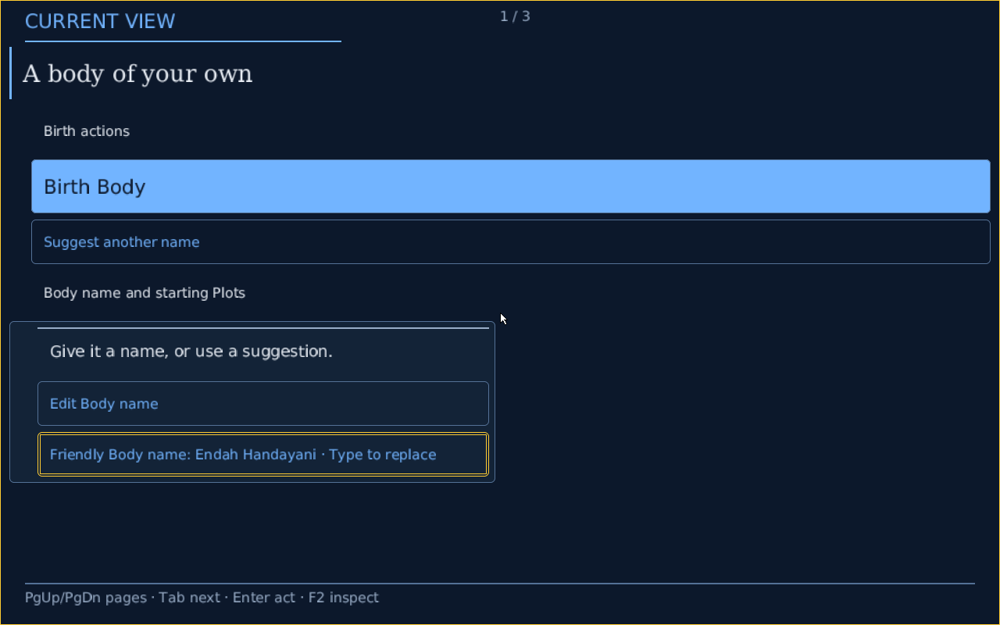

# Native independent Look selection, 2026-10-20

Progress toward #5628 / #5994 step10, after real surface styling on 7d5aacbab. This adds actual local Crèche selection and shared checked Source profiles. Todo owner-window control still exposes its existing paired presets; its independent control entrance and admitted icon application remain unfinished. This is not complete issue acceptance.

## Source and preparation

F6 toggles compact/spacious density; F7 toggles engineering/Phosphor versus editorial palette in the local Crèche. Four finite Source expressions are admitted over each existing checked single/column component, with scale 100 for compact and 125 for spacious. The same combinations reuse both existing flat/grouped Todo components. The matrix comprises 16 authored roots, not an arbitrary style parser. Existing compact/spacious helper APIs still address their same meaningful Source presets.

`ComponentVisualSelection` is an unserialized Rust address for those finite Source roots. It supplies no alternate Look schema, startup values or control authority: canonical VisualExpressionInfo still comes from checked Source and the exact selected Plan. Accessibility constraints remain separate user requirements. Native owner-route reconstruction recognizes all four profile roots through the same selected-Host admission; the existing owner protocol/UI is not falsely claimed to expose all of them yet.

A new local Mask is fully prepared before the old Show retires. An explicit transfer moves the existing bounded unsubmitted encounter into the prepared replacement; no Show/session authority moves. The producer Plan must match. Restoring state requires identical Face identity/revision and interaction policy, refuses submitted transactions, remaps focus to the new measured row/page, and checks its frame before publishing the new Show. Existing semantic refresh behavior is unchanged unless this explicit transfer was requested. No preference key dispatches a Face action or creates/advances a Body.

## Diagnostics and resources

Selection records join compact Source/component, root, recipe canonical-byte SHA-256 and size, expression/outcome/fallback, render counts and exact old/new Show identifiers to the separately emitted complete native Face/manifestation publications. The new record uses the existing test-aware emitter with a 65,536-byte limit. It does not duplicate the large embedded planned Mask twice. Producer scope and Face checks prevent state transfer across unrelated encounters. No font asset, glyph corpus, graphics command/text/row/surface limit or action/owner state is added.

Initial checks caught an oversized diagnostic payload, test-only privileged serial I/O, and a test assertion reading an already consumed input session. The payload now retains compact identifiers/provenance instead of full duplicate plans; the existing hosted/native emitter is reused. No enlarged test stack is required, and the final tests use the normal stack. Failed attempts are not successful validation.

## Focused checks

132 non-overlapping focused checks pass, with two existing manual compositor performance observations ignored:

- `product_front_door::face_arrival::`: 4 passed, including four live preparation/publication transitions, invariant Face/component/recipe/focus, fresh Shows, unchanged interaction sequence, and an unsubmitted draft eventually submitted against the current Show.
- `native_face_scene::`: 97 passed, including different-Face revision refusal, existing full owner-Face/readability/layout/raster/control checks.
- `native_face_mask::`: 12 passed, including different producer-Host refusal, failed scanout/no Show and existing checked Crèche/typed input behavior.
- `native_compositor::`: 15 passed, 2 manual observations ignored; retained raster, damage, refusal and palette checks.
- Configured native offer crate: 4 passed, including all 16 roots reproducing identical checked component/recipe per structure, exact independent expressions and distinct sealed Plans, plus unsupported Host refusal.

The separate `selection` filter also passes 17 checks, overlapping some of the above and covering existing domain-selection guards; it is not added to the 132 count. [Logs and hashes](evidence/native-look-selection-20261020/). Builds use `CARGO_PROFILE_TEST_DEBUG=0`; no elevated stack setting in the successful runs.

## Product check to follow

The ordinary canonical QEMU journey now includes four preference captures and joins every transition to validated native Face/manifestation receipts. It requires unchanged full Face, component and canonical recipe hash; requested axes/scale; fresh available Shows in the same Host/Boot/generation; bounded commands; no Body action; and return to the original planned configuration. The ordinary capture admission rises 23→27 within the existing absolute 32 ceiling, allowing 26 expected captures plus one failure capture. The separate instrumented latency journey retains its prior workload and capture limit, explicitly marking Look transitions unexercised.

A fresh source-pinned image/run is required before claiming product success. Earlier captures remain attributed to 7d5aacbab and earlier typography source 6a8e127b4. Direct-dev/standard CI bypass follows the user's explicit instruction. #6158 stays skipped; broader layout #6159 and complete focus/accessibility #5629 remain separate.


The first fresh QEMU attempt on cedf08fb2 refused before any preference key: the new verifier incorrectly decoded the existing native-face/v1 compact Show receipt as a full MaskShow. The decoder now follows the installed compact receipt and its typed manifestation, validates their Face/Host/Boot/Plan/Play bindings, and retains the shared full-journey correspondence check. This failed attempt is not product acceptance.


## Actual selection before enlarged-font filtering

Clean unchanged source **76e6e48c82f78af1c402c27b191ad8f4202eb8ac** completed both canonical normal-product build and `make host verify --journey` with exit 0. Final ISO SHA-256 `4047bda49ebeed351efdd6d17c0a64b898919ac86ae8f02b218d8285cab9d62e`. Four actual keyboard preference transitions passed, plus the original 22 lifecycle/interaction checkpoints: 26 screenshots total. Face, checked component and recipe stayed identical; exact fresh Show/Host/Boot/generation bindings, zero Body actions and return to the original planned configuration were checked. All 26 original PNG sizes/file hashes and decoded RGBA hashes independently matched the capture manifest. [Complete source-bound records and PNGs](evidence/native-look-selection-20261020/selection-before-font-filter/). This proves actual selection, not complete issue acceptance.

Inspected compact editorial, spacious editorial and compact engineering images. Actual 125% nearest-neighbor text looked visibly rough, so this run is explicitly the **before-filter** evidence. Its functional success does not assert that enlarged typography already met the user's visual quality request.

## Enlarged-font coverage refinement

At 100% the original pinned grayscale coverage remains byte-for-byte the sampling path. At larger admitted scales, fixed four-tap integer bilinear coverage filtering replaces repeated nearest-neighbor texels. Sampling uses destination pixel centers and clamps within the selected glyph's original atlas rectangle, never borrowing a neighboring glyph or creating a new ink extent. RGB blending against retained pixels remains unchanged. The filter allocates nothing, uses no floating-point operations and reads at most four coverage values per output sample. Glyph metrics, bearings, advances, measured extents, scale admission, assets and budgets stay unchanged; neither a font parser nor a new atlas is added.

After this refinement, 137 non-overlapping checks pass: 21 typography, 97 native scene, 15 compositor and 4 arrival tests; two existing manual compositor performance observations remain ignored. Checks include numerical reconstruction, unchanged metrics/default sampling, real binary-fallback gray coverage at enlarged scales, bounded glyph ink, actual layout/raster guards, retained damage equality, state transfer and current-Show draft submission. These are the new `5628-scaled-font-filter.log` / `5628-filtered-*.log` records in the evidence directory. A fresh normal-product image and visual check follow before claiming filtered-font product success.


## Filtered-font ordinary product acceptance for this slice

Both canonical commands exited 0 on clean unchanged source **56d2dfefbd0d95f0a969eb77d5e078a5d638243d**:

```sh
CARGO_PROFILE_DEV_DEBUG=0 cargo xtask make host build targets/conduitos/profiles/conduitos-native.host.conduit --output /home/dancxjo/Documents/Codex/2026-10-20/goal-bypass-the-standard-proof-and/work/5628-native-selection-filtered-1/image --locked
CARGO_PROFILE_DEV_DEBUG=0 cargo xtask make host verify /home/dancxjo/Documents/Codex/2026-10-20/goal-bypass-the-standard-proof-and/work/5628-native-selection-filtered-1/image --journey --locked
```

Final ISO SHA-256 is `a8e2268bf33d7b209182d9a60567b00df9e85898b58125f4a3687b9d3e1f53ef`. The separately resolved guest image binding is `image:sha256:c52750cb2bd5086bb41ded70bc88006ddd73a77e767b6a9f5bbe38f9c14e7c03`; these identities are not interchangeable.

All 26 actual captures and the original 22 lifecycle/interaction checkpoints plus four real keyboard Look transitions passed. The source Face, checked component and recipe stayed identical across the four views, with fresh Shows, no Body action and return to the initial planned configuration. Render counts were 47, 24, 24, 47 commands, below 48. All 26 PNG sizes/file hashes and decoded RGBA hashes independently matched the original manifest. All three generated typography resource files byte-for-byte match the previously accepted resource ledger, including 761,651 coverage bytes; no font asset grew. [Complete raw evidence, hashes and PNGs](evidence/native-look-selection-20261020/filtered-product-capture/).

Inspected the real 125% editorial frame against the earlier nearest-neighbor frame. Enlarged serif/Sans text is visibly smoother; the source field and focus remain intact. Layout/continuation is unchanged by the filter: the spacious profile legitimately reports 1/3, and no claim is made to fix explicitly skipped #6158 or redesign #6159 arrangement.



Only manifest-bound PNGs are part of these source-scoped archives. An old failure PNG left in the shared target directory by the cedf08fb2 verifier refusal was excluded from the earlier successful source archive; its actual failed trace remains preserved separately. This avoids attributing an unreferenced older frame to 76e6e48c8.

The incoming dev integration d79897e6a contains import formatting and moves the unchanged rounded-shape function before its tests. It is integrated without rebasing these captured sources. Captures continue to name 56d2dfefb; the later formatting/evidence/merge commits are not relabeled as captured trees.

Remaining #5628 work includes independent Todo owner-window controls and admitted icon placement, plus the issue's complete fallback/resource acceptance. Focus/accessibility #5629 and full product matrix #5608 remain their own later serial gates. Physical/human evidence is false, full CI was bypassed by user instruction, and no cosmetic speedup or parent completion is claimed.
