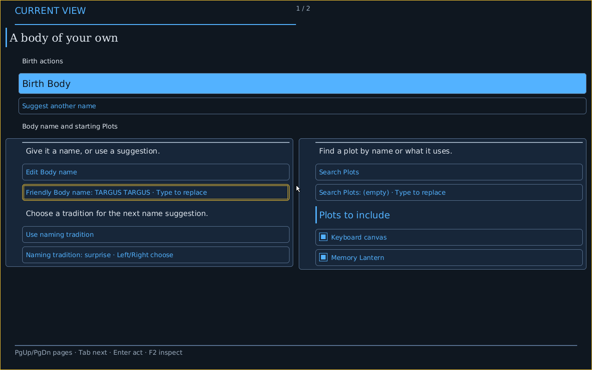

# Native Look surfaces and primary actions, 2026-10-20

Progress toward #5628 / #6174, following the bounded paint/antialiasing foundation a066837f9. This applies actual scene styling and changes the admitted editorial palette to the requested navy direction. It does not complete independent product selection, finite icon application, fallback/resource inspection or the full visual acceptance matrix.

The existing checked recipe and admitted density/text scale continue measuring the same Face. Panels now use Surface rounded fills and Border rounded outlines. Both commands are reserved before admission, including command-pressure continuation. Panel backgrounds are emitted before all row content: checked geometry ordering can differ from the restored semantic reading order, so a row-local background could otherwise overwrite an earlier row's ink.

Available primary actions, identified by their source-owned primary disclosure rather than their labels/identities, receive an Accent rounded fill, outline, and Background label ink. The existing heading-marker command is repurposed for the outline, so primary styling adds no row command. Secondary controls receive quiet rounded outlines; unavailable actions retain explicit wording and muted treatment. Forced colors preserve black label ink over white action fills and the existing non-color focus marker. Dark primary labels deliberately favor contrast over the reference illustration's white label.

Editorial uses navy background/inset surfaces, light body text, readable muted text and blue accents. Numeric test-only sRGB checks require text against surfaces and primary label/fill contrast at least 4.5, and outlines against surfaces at least 3.0, under both admitted palettes and forced colors. This is a finite palette check, not a claim to complete accessibility acceptance. The top accent bar now represents the actual local `(page + 1) / pages` position; it conveys no workload progress. The footer separator uses Border.

## Focused validation

122 tests passed, 2 existing manual performance observations ignored:

- `CARGO_PROFILE_TEST_DEBUG=0 cargo test --locked -p conduitos --lib --features native-compositor native_face_scene::`: 96 passed, 0 ignored. Includes actual current owner Faces, complete Details, wide/narrow and 100–200% measured/rasterized text, canonical pages, source controls and typed Boolean/text interaction. New regressions cover available/unavailable primary disclosure across both densities/palettes/extents/scales and actual Crèche panel paint ordering within the fixed 48-command limit.
- Same built native unit binary, `native_face_mask::`: 11 passed, 0 ignored, including current-Show binding, failed scanout refusing Show publication, real checked Crèche recipes and long/empty/filtered names.
- Same binary, `native_compositor::`: 15 passed, 2 manual performance observations ignored, including actual palette contrast and incremental/fresh raster equivalence.

[Full logs and hashes](evidence/native-look-surfaces-20261020/). No new assets, dependency, command limit, semantic action/value, reading order, field-cluster policy or owner authority. #6158 remains explicitly skipped; no pagination policy fix is claimed. #6159 remains broader layout work and #5629 remains focus/accessibility acceptance.

## Fresh ordinary product capture

Both supported commands exited 0 on clean, unchanged source **7d5aacbab7b296c5e446788aa04082ee848a3925**:

```sh
CARGO_PROFILE_DEV_DEBUG=0 cargo xtask make host build targets/conduitos/profiles/conduitos-native.host.conduit --output /home/dancxjo/Documents/Codex/2026-10-20/goal-bypass-the-standard-proof-and/work/5628-native-surfaces-current-1/image --locked
CARGO_PROFILE_DEV_DEBUG=0 cargo xtask make host verify /home/dancxjo/Documents/Codex/2026-10-20/goal-bypass-the-standard-proof-and/work/5628-native-surfaces-current-1/image --journey --locked
```

The canonical build also completed its bare-metal library check and optimized kernel build. Final ISO SHA-256 is `91936dfa9d901b43660310bd83036552f51eccacb248aa19cd41811606eecc48`. Guest resolved-description image binding is separately `image:sha256:c4b05823e9f1a8807b50f2cff424807de662bb3ba962f83c5ec5a6c4227ec114`; it is not the ISO hash.

The actual one-CPU QEMU product journey completed **22 checkpoints and 22 screenshots**, including keyboard and pointer 4→3→4 choices, Birth, lifecycle/retained domains, Home return and actual Patchbay inspect/return. The complete raw serial, QMP, journey proof, paired linear record, build/resolution records, source/status record, PNGs and their original manifest are [retained here](evidence/native-look-surfaces-20261020/product-capture/). Independently checked all 22 PNG byte lengths/file hashes and decoded RGBA hashes against the original manifest. The archived proof records preserve their original capture paths; matching retained copies are under the archive's `x86_64/` directory. No records were relabeled as the later evidence-only commit.

Inspected real Crèche, Home, Body playing and Patchbay diagram PNGs. The Crèche shows antialiased rounded inset cards, a filled primary Birth action with dark high-contrast text, quiet secondary outlines, serif title, measured Sans controls, gold field focus and a half-width 1/2 page bar. Backgrounds precede text and do not erase it. The default Crèche's checked Source expression remains compact Phosphor at 100%; this capture does **not** assert actual editorial selection, two-Look swap or forced-color product acceptance. Editorial palette/density combinations remain covered by CPU tests only.



Deliberate differences from the #6174 illustration: exact source-owned names/order/values and available actions remain authoritative; the primary action remains in its existing full-width checked placement and uses dark label ink; no new shadow/gradient operation, italic resource or icon binding is invented. Card field arrangement/continuation is not redesigned here (#6159, and explicitly skipped #6158). The product Home/Body use their existing renderer paths, not a falsely unified scene implementation.

This is freestanding-emulator evidence. Human enactment and physical evidence remain false, and parent acceptance remains open, as the original records state. No boot-speed, performance or complete #5628/#5629/#5608 claim. Older QEMU typography captures remain attributed to their original source. Full CI conventions and a PR are bypassed under the user's direct-dev instruction.
