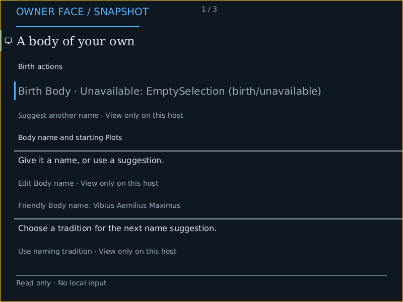

# AArch64 firmware-backed native Face

Development evidence for [#6057](https://github.com/dancxjo/conduit/issues/6057),
G1/G2: a normal PROFILE-built AArch64 product image renders the canonical
Crèche Face through the shared `NativeFaceMask`, checked Mask Plan/Play and
acknowledged Show. The image below is a lossless QMP capture from that guest.



This optional graphical profile admits display output without a local input
provider. The footer says “Read only · No local input”; there are no key hints
or actionable hit regions. The existing serial profile and canonical live-media
selection remain distinct. Local input and the complete native Body journey
remain [#6060](https://github.com/dancxjo/conduit/issues/6060). This is development
emulator framebuffer evidence. Candidate, combined Integration, stable
publication, physical display and GPU acceleration have separate obligations.

## Source and machine

The [retention index](../../targets/conduitos/proof/firmware-frame/aarch64-f96860659/index.json)
hashes both raw captures, serial transcripts, QMP traces, launch records, normal
BUILD manifest, ordinary product proof and negative controls. Original absolute
paths remain in raw records; the index locates their retained copies. Large
raw records are losslessly gzip-compressed, with compressed and original-byte
hashes recorded separately. Both image
and collector were built from clean source
`f96860659760660fc796e7694df5bee4bd9f2bb8`. This commit remains in this change's
history; the later evidence-only commit does not claim a new guest execution.

| Fact | Observation |
| --- | --- |
| Product | `conduitos/aarch64/virt`, `product-host` artifact |
| Emulator | QEMU 10.2.1, Debian `1:10.2.1+ds-1ubuntu3.2`; executable hash in each launch record |
| Machine | `virt`, `neoverse-n2`, one CPU, 512 MiB RAM, no network |
| Firmware | QEMU EFI `2025.11-3ubuntu7.3`, SHA-256 `e264b5d66d05ad3abad9ec0b63dcf0c956007a3af9345dd03f79c5246ffcb392` |
| Bootloader | Reviewed Limine 12.5.2, archive hash and IMAGE identities in BUILD manifest |
| Display | Firmware GOP/Limine RGB framebuffer from actual `ramfb` |
| Format | 800 × 600, 32-bit RGB, pitch 3,200 bytes, extent 1,920,000 bytes |
| Mapping | 469 covering pages checked by `AT S1E1W`, exact physical addresses, uniform normal WB attribute `0xff` |
| Completion | Observed 64-byte cache lines; touched lines cleaned to PoC, then `DSB SY` before renderer return/Show acknowledgement |
| Admission | Four surface slots, 8 MiB surface budget, 256 MiB preparation arena ceiling |
| Launch to verified capture | 10,001 ms and 9,208 ms; each guest has a 45-second deadline and 1 MiB transcript bound |
| Rendering work | 480,000 scanout pixels per frame; 505,210 / 505,419 offscreen pixel writes |
| First PNG SHA-256 | `6f76d6d7ec226e47d79aa093a8a64f4e246ae0f741c960dc9ba97d95a1c356c2` |
| Second PNG SHA-256 | `65a8b056884c40a880a9d81d5ad0608e7c3ff6fe7583ffa96f21b76d77f3eadb` |

Both independent boots have fresh HostId and BootId, an acknowledged Show and
matching provider/Face/Mask/image identities. Their generated friendly names
and boot-scoped identities differ legitimately; no pixel or Face-identity
equality is asserted. Only the observed 800 × 600 mode and first read-only
Crèche page are runtime-proved here. Hosted layout tests do not establish a
second firmware display mode, input navigation or frame-update performance.
Launch-to-capture is a wall-clock observation, not isolated rendering CPU time.

## Admission and refusal

Host construction retains the package's serial anchor and admits one uniquely
eligible optional native presenter when the selected scanout and finite surface
resource close its prerequisites. It retains metadata requirements of an
existing native anchor and rejects competing alternatives. The portable graphics
feature does not pull in the x86 owner-network front door.

The AArch64 leaf checks the current EL1 translation regime, bootloader-reserved
framebuffer coverage, finite extent and every actual write translation. It
accepts uniform normal NC or WB mappings. WB requires whole cache-line custody;
span envelopes are checked before stores. Translation faults, wrong physical
addresses, mixed/unsupported attributes and invalid geometry refuse in focused
conformance tests. No physical cache-coherency claim follows from this emulator.

The [absent-framebuffer control](../../targets/conduitos/proof/firmware-frame/aarch64-f96860659/no-framebuffer/receipt.json)
launches the same exact image without `ramfb`: the guest refuses with
`display-absent` and emits no graphical Show. The
[dirty-source control](../../targets/conduitos/proof/firmware-frame/aarch64-f96860659/dirty-source/receipt.json)
uses the supported verifier and receives `firmware-frame-source-dirty` before
guest launch, then removes its owned marker. Neither is a graphical pass.
The earlier [G0 negative machine probe](../audits/aarch64-ramfb-g0-20261023.md)
remains retained with its own historical image and tool identities.

## Reproduction and validation

With the pinned Rust target, normal image tools, `qemu-system-aarch64` and matching
QEMU UEFI firmware prepared, use the supported entrances at the retained source:

```sh
cargo xtask make host build targets/conduitos/profiles/conduitos-aarch64-graphical.host.conduit --output target/host-build/aarch64-graphics
cargo xtask make host verify target/host-build/aarch64-graphics --boot
```

The verifier starts two fresh guests, checks actual product/mapping/Show records,
captures lossless PNGs and stops each guest. Persistent launch and the five-Host
comparison remain work in #6057. The launch records identify this machine's
local extracted emulator/firmware paths; those paths are observations, not a new
public setup interface. Boot verification performs no firmware download.

Retained local validation includes strict native-feature and xtask all-target Clippy, 67
Host construction tests and 19 target-lowering tests. The direct scene
input-refusal test passed in the exact-source scene suite. The changed
graphics, scene/Mask, compositor, display, boot, Make and provider
suites have separate exact-source receipts and logs. Deliberately manual
performance and opt-in Node CPU cross-Mask cases remain ignored, not passed.
A broader native-feature library run was terminated by SIGTERM (exit 143)
during protocol-operation tests before completion. Its partial log is retained
as incomplete, not as a full-library pass. These local results do not replace
Candidate or combined Integration.

| Focused suite | Passed | Ignored |
| --- | ---: | ---: |
| `native_face_` | 169 | 1 |
| `native_compositor::` | 18 | 2 |
| `native_mask_play::` | 11 | 0 |
| `display::` | 38 | 1 |
| `boot::` | 56 | 0 |
| `make::` | 7 | 0 |
| `product_bases::` | 4 | 0 |
| `arch::aarch64_framebuffer` | 7 | 0 |

## Reuse

The user-authorized handoff preserved the older
[`work/6057-aarch64-frame-cached` branch](https://github.com/dancxjo/conduit/tree/work/6057-aarch64-frame-cached)
and its evidence. This change refreshes only the mapping/cache leaf, shared
firmware-Face preparation, optional Host closure and bounded capture path onto
current APIs; it does not absorb stale branch ancestry. The first refreshed
clean capture source is separately preserved as
[`prep/6057-aarch64-proof-65a164734`](https://github.com/dancxjo/conduit/tree/prep/6057-aarch64-proof-65a164734).
The checked-in packet above uses the later refreshed source and accurate
inputless footer. IA-32, RISC-V64 and LoongArch64 remain independent next slices.
