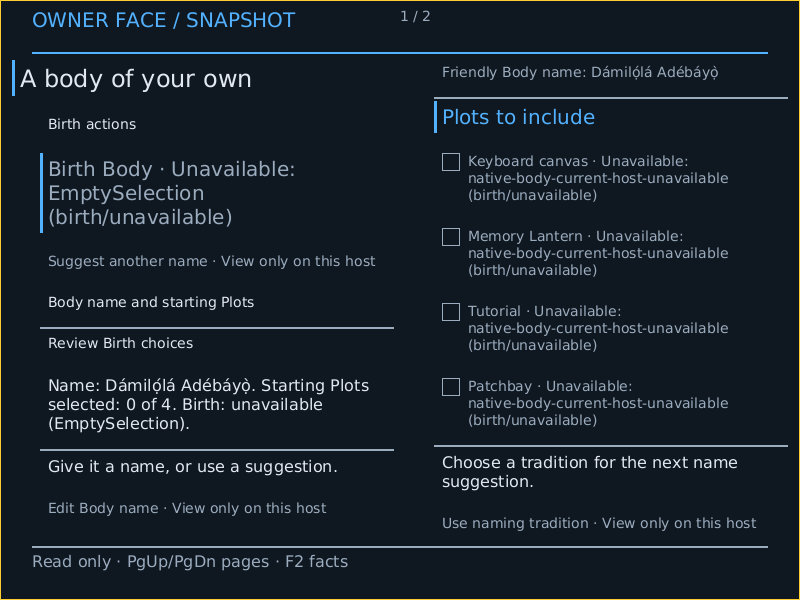

# AArch64 firmware-backed native Face

Development evidence for [#6057](https://github.com/dancxjo/conduit/issues/6057),
G1/G2: the normal AArch64 PROFILE-built product renders the canonical Crèche
Face through `NativeFaceMask`, its checked Mask Play, and an acknowledged Show.
The pixels below came from QEMU `screendump`; they are not a host canvas.



This Host is read-only. No keyboard or pointer provider is admitted, and the
native Body workset correctly reports this current Host as unavailable. The
local input and complete Crèche → Body → Patchbay journey belong to
[#6060](https://github.com/dancxjo/conduit/issues/6060). This is development
emulator evidence, not accepted-release, physical display, or GPU proof.

## Retained run

The [retention index](../../targets/conduitos/proof/firmware-frame/aarch64-8ad4c4ec1/index.json)
hashes the original captures, serial transcripts, QMP trace, launch metadata,
BUILD manifest and ordinary product proof. Original absolute paths remain in
raw records; the index locates their retained copies.

| Fact | Observation |
| --- | --- |
| Source | `8ad4c4ec1b869efb076d0de06165930f03e4c947`, clean at both launches |
| Product | `conduitos/aarch64/virt`, normal product artifact |
| Emulator | QEMU 10.2.1, Debian `1:10.2.1+ds-1ubuntu3.2` |
| Machine | `virt`, `neoverse-n2`, one CPU, 512 MiB, no network |
| Firmware | QEMU EFI `2025.11-3ubuntu7.3`; SHA-256 `e264b5d66d05ad3abad9ec0b63dcf0c956007a3af9345dd03f79c5246ffcb392` |
| Display | Firmware GOP/Limine framebuffer supplied by `ramfb` |
| Format | 800 × 600, 32-bit RGB, pitch 3,200 bytes, 1,920,000 bytes |
| Translation | All 469 covering pages checked with `AT S1E1W`; exact physical addresses, uniform normal write-back attribute `0xff` |
| Store completion | Observed 64-byte data-cache lines; clean touched lines to PoC, then `DSB SY` before the renderer returns and acknowledges its Show |
| Surface admission | Four slots and 8 MiB; one observed framebuffer Base, no invented input Base |
| Boot-to-verified-capture | 21,427 ms and 20,379 ms, within each 45-second boot deadline |
| First capture | 480,000 scanout pixels written; PNG SHA-256 `9c59a528854f86bcf7afc9fa964fa8a8c7af7528e77aa5322829995eeb73e51e` |
| Independent boots | Fresh HostId and BootId on the second boot; both captures independently verified |

Construction retains the package's serial presenter and adds one uniquely
eligible optional graphical presenter from the explicitly selected scanout and
surface budget. Competing optional realizations refuse. The runtime rendering
Back, Mask Plan/Play, Face, Show and provider identities remain in each capture;
construction selection does not substitute for observing and admitting the
actual display.

The ordinary protected Source execution, its semantic result, and Observatory
snapshot remain in [the product proof](../../targets/conduitos/proof/firmware-frame/aarch64-8ad4c4ec1/product-proof.json).
Serial output and graphical realization retain their separate identities.

## Mapping and refusal boundary

The machine leaf checks EL1, its translation regime, bootloader-reserved
framebuffer coverage, a finite 8 MiB extent, and actual write translations. It
accepts uniform normal NC or normal WB mappings. WB requires validated,
whole-line-owned geometry; pixel spans are checked before stores, and cache
maintenance stays within the admitted framebuffer. Unsupported attributes,
mixed mappings, faults, wrong physical addresses and invalid geometry refuse.

The earlier NC-only implementation correctly refused the real WB mapping before
writing pixels. Its [original observation and refusal](../../targets/conduitos/proof/firmware-frame/aarch64-8ad4c4ec1/prior-nc-only-refusal/serial.log)
are retained with their own source checkpoint. The boot collector now reports a
complete guest refusal separately from a timeout.

The cache-line traversal and completion mechanism follow the architectural
sequence shown by Arm Trusted Firmware's
[cache helpers](https://github.com/ARM-software/arm-trusted-firmware/blob/master/lib/aarch64/cache_helpers.S)
and [CTR_EL0 line-size extraction](https://github.com/ARM-software/arm-trusted-firmware/blob/master/include/arch/aarch64/asm_macros.S).
Their use here proves the selected emulator path, not physical scanout behavior.

## Rerun

From the retained source checkpoint, use the normal supported entrances:

```sh
cargo xtask make host build targets/conduitos/profiles/conduitos-aarch64-virt.host.conduit --output target/host-build/aarch64-graphics
cargo xtask make host verify target/host-build/aarch64-graphics --boot
```

Verification starts two fresh guests, checks actual Face/Show and mapping
receipts, retains lossless PNGs with source/machine evidence, and stops each
guest. This command is not the persistent interactive launcher tracked in G4.

The earlier hosted renderer-preparation suite passed 1,111 tests with zero
failures; two optimized performance observations remain deliberately manual. Seven focused mapping and
cache conformance tests passed, including partial-line, overflow, wrong physical
address, mixed-policy and unsupported-policy refusals. Nine Host construction and twenty related ConduitOS configuration regressions
passed, as did fifteen target-lowering tests and the complete-refusal boundary
test. Full workspace Clippy/tests and release acceptance remain separate
obligations before promotion.
