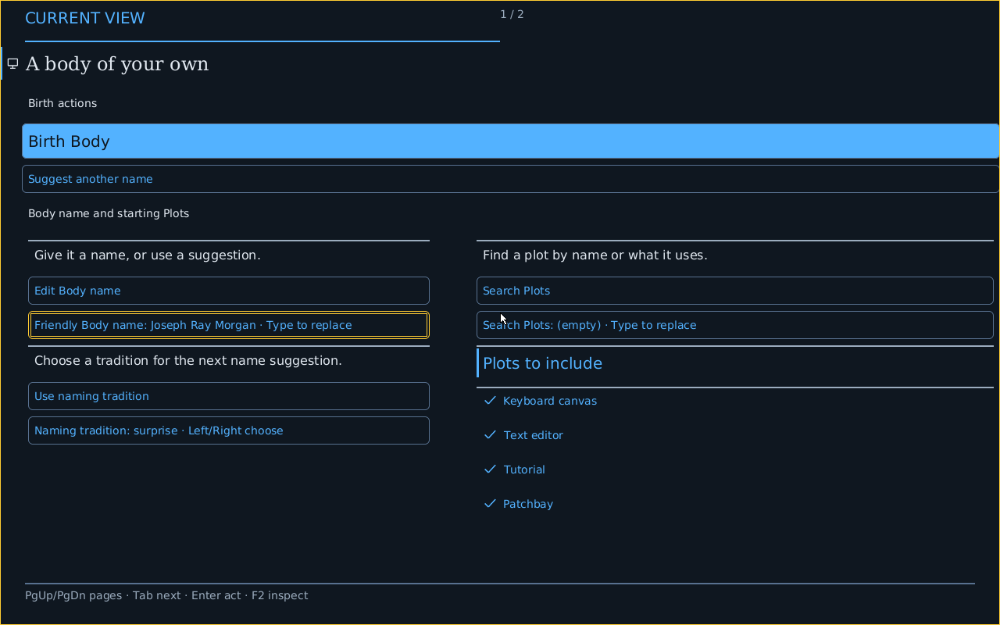
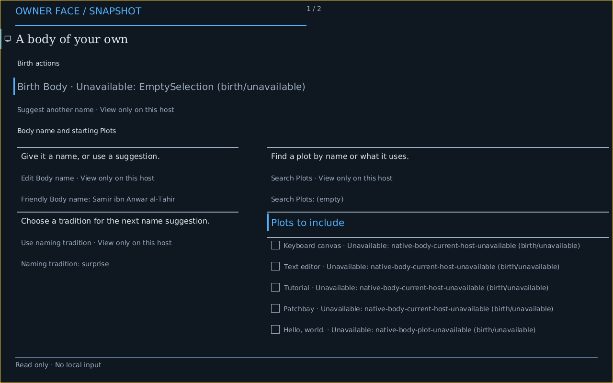

# Firmware-frame comparison: three retained references

This is partial evidence for #6057. Normal PROFILE-built x86_64, AArch64 and
IA-32 products have real QMP captures of the same authored Crèche projection
and checked Mask. RISC-V64 and LoongArch64 graphical frames, the complete
five-architecture PNG comparison, capability matrices and persistent launcher
remain open. This report does not establish full product parity or stable
release acceptance.

| x86_64 PC | AArch64 virt | IA-32 PC |
| --- | --- | --- |
|  |  |  |
| 1280×800; pitch 5120; 32 bpp; firmware RGB scanout through QEMU std VGA | 800×600; pitch 3200; 32 bpp; firmware RAM framebuffer | 1280×800; pitch 5120; 32 bpp; UEFI32 GOP through QEMU std VGA |
| `creche-ready`, before Birth; keyboard and pointer exercised later | First source-backed read-only Show; local input unavailable | First source-backed read-only Show; local input unavailable |

The thumbnails may be scaled by the viewer. The underlying lossless PNGs retain
actual dimensions. Pixel equality is neither asserted nor used as semantic proof.

## Source and behavior

The x86 runtime source is `abd896d14633a45c69d93996bcebee0e343cbfd7`.
The AArch64 runtime source is `f96860659760660fc796e7694df5bee4bd9f2bb8`;
its [separate report](conduitos-aarch64-firmware-frame.md) describes the machine
mapping, cache completion, ownership, bounded rendering and negative controls.
The IA-32 runtime source is `64d5130753466f44c0b605ad6b366d54083eeafd`;
its [separate report](conduitos-ia32-firmware-frame.md) retains both actual
UEFI32 boots, explicit mapping/cache custody and actual negative controls.
Later evidence commits do not change those runtime identities.

The [two-architecture audit](../../targets/conduitos/proof/firmware-frame/x86_64-abd896d14/two-architecture-semantic-audit.json)
joins the x86 checkpoint to its actual acknowledged Face and compares the retained
AArch Face. Both carry identical Source, Checked and Expanded projection IDs,
and identical Source, Checked and Expanded Mask plot IDs. Their concrete Plans,
Host/Boot/Face/Show identities and owner availability are distinct.

In x86, four starting Body choices and Birth are available. The AArch Host reports
those four choices as `native-body-current-host-unavailable` and Birth as
`EmptySelection`. Both still expose five Plot subjects. Their Faces contain
27 and 23 subjects respectively, including six and two Status subjects. These
are substantive typed capability differences, not a claim that the AArch image
can run the x86 workset. AArch's Mask also refuses local input independently of
what its owner can describe. The [IA-32 artifact and semantic audit](../../targets/conduitos/proof/firmware-frame/ia32-64d513075/independent-audit.json)
checks the same projection and Mask identities against both references. IA-32
agrees with AArch64 on all current owner-action availability and the five typed
Plot subjects. It presents the wider 1280×800 view with the same read-only
notice; its different boot-generated name is retained rather than normalized.

The x86 journey retained 27 real PNG checkpoints and 61 paired native/linear
Face records, one Birth, 17 accepted actions and one unavailable Wake. The
supported verifier passed the actual action/owner/Show correlations, refusal
and recovery, checked Look changes, pointer transitions and protected editor
journey. The paired linear records reconstruct the same emitted Faces; they
are not another enacted linear Mask. This proof is neither physical scanout,
human enactment nor GPU acceleration.

## x86 machine and retained custody

The launch uses QEMU `q35`, CPU `max`, 512 MiB, one CPU, `std` VGA, emulated xHCI
keyboard and mouse, and the normal hybrid ISO's BIOS entry. The exact arguments,
source/image binding, serial offsets, adjacent native receipts, pixel and PNG
hashes are in the [capture manifest](../../targets/conduitos/proof/firmware-frame/x86_64-abd896d14/frames/manifest.json.gz).
The normal boot reports one framebuffer. The [scanout observation](../../targets/conduitos/proof/firmware-frame/x86_64-abd896d14/observed-scanout-geometry.json)
joins 23 compositor snapshots to that same Host/Boot and Profile/Build/Image,
proving the stated pitch, bpp and RGB channel shifts. It does not newly measure
x86 physical address translation or cache attributes.

The original journey selects QEMU's default firmware without an explicit
`-bios` argument. A separate paused startup probe, with the same machine,
device and image options, traces the opened SeaBIOS and std VGA ROM files.
Their exact hashes, QEMU executable hash/version and observed package versions
are retained in the [packet index](../../targets/conduitos/proof/firmware-frame/x86_64-abd896d14/index.json).
This supports an inference about default firmware selection for the completed
journey; it is not a retroactively added measurement in that journey. The probe
executes no guest instructions and proves no additional frame. Its first attempt
rejected an invalid `-qmp none` option; both that diagnostic and the corrected
probe remain separate from successful product proof.

The [product journey receipt](../../targets/conduitos/proof/firmware-frame/x86_64-abd896d14/proof/x86_64-product-journey-proof.json.gz)
retains the full verifier result, including compositor lifecycle collection.
Raw serial and QMP logs, full Faces, source actions, editor receipts and all PNGs
are losslessly retained; compressed files preserve original byte hashes.

The ISO SHA-256 is `5fd72392680c86522159f2855ea8694cb6b734346cf0abb57f7b7fbec38a1791`.
The source checkout stayed clean and unchanged. A local wrapper stopped after
the successful build because free disk space was below its 4 GiB guard. After
reclaiming inactive compiler caches, the journey and final artifact verification
used the same immutable ISO. The earlier wrapper receipt is retained; there was
no guest failure, image substitution or replacement build.

## Reproduction and remaining acceptance

At the pinned x86 source, with the repository's normal x86 tool prerequisites:

```sh
cargo xtask make host build targets/conduitos/profiles/conduitos-native.host.conduit --output target/host-build/6057-x86-gallery-abd896d14
cargo xtask make host verify target/host-build/6057-x86-gallery-abd896d14 --journey
cargo xtask make host verify target/host-build/6057-x86-gallery-abd896d14
```

The journey verifies the supplied normal product image; it never rebuilds it.
It deliberately stops its guests. A persistent user launcher is still required
by #6057. Remaining architecture frames must retain comparable source, machine,
geometry, input/absence and acknowledged Show evidence. This three-architecture
reference does not satisfy the five-architecture exit condition.
