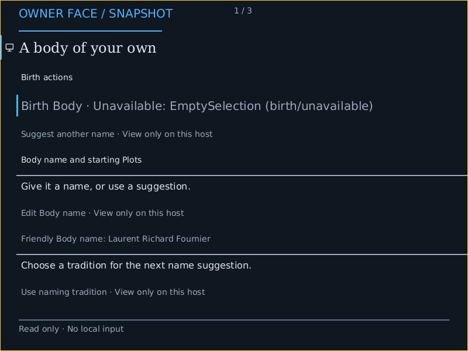
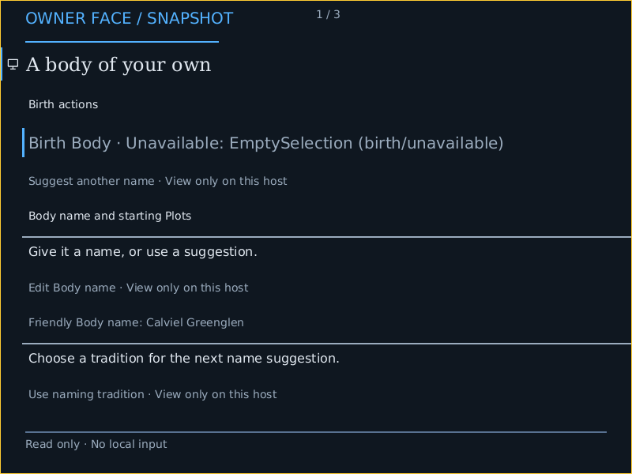

# Normal LoongArch64 firmware-framebuffer product (#6057)

At source `11fd0027ee3342bbbb50f501ec4c60f78c346065`, the normal optional
graphical PROFILE built and passed two fresh QEMU product boots. Both show the
shared source-backed read-only Crèche through checked Mask execution and an
acknowledged Show. These are normal `product-host` artifacts, with no proof
instrumentation or separate UI implementation. The default live profile remains
serial. Local input, physical scanout and GPU acceleration are not established.

The [complete packet](../../targets/conduitos/proof/firmware-frame/loongarch64-11fd0027e/index.json)
retains actual ELF/ISO bytes, manifests, full serial/QMP output, PNGs, source and
machine bindings, focused checks, negative controls and failed preparation
attempts. The [independent audit](../../targets/conduitos/proof/firmware-frame/loongarch64-11fd0027e/independent-audit.json)
checks all image/kernel hashes, finds the complete ELF inside the ISO, decodes
PNG CRCs/RGBA pixels, and joins actual Shows to their Base and boot provenance.

| First fresh boot | Second fresh boot |
| --- | --- |
|  |  |

Both are 800×600, pitch 3200, 32 bpp, RGB shifts 16/8/0, 1,920,000 bytes. Their
boot-generated names and Host/Boot/Face/Show identities differ. These are two
fresh revision-1 Shows, not an input-driven second revision. The first normal
source-backed frame is the Crèche snapshot. Its complete Face retains five Plot
subjects; only the selected viewport is captured. No page-key or pointer path
is admitted by this Host.

## Machine and custody

The selected machine is QEMU `virt`, CPU `la464`, 2 GiB, one CPU, single-thread
TCG, virtio-blk boot media and firmware `ramfb`, with no network or local input
provider. The prepared QEMU 10.2.1 diagnostic variant retains both reviewed
MISC/DRDTL corrections. Its actual executable SHA-256 is
`ad9ed950138b7fc2e2c2e86dd258c94216b1116becbf76126b4e429eabe4c477`.
This is the reviewed corrected emulator route, not stock-QEMU or physical proof.

The single Debian EDK2 ROM is `2025.02-8+deb13u1`, selected as a 4 MiB `-bios`
image with SHA-256
`b4c32ce95a54346c8bc180241a21ad763c5fcf43310e95aa93ed58bf0cc0864e`.
Its package pin and exact extraction are retained by the preparation code.
There is no CODE/VARS pair. Explicit graphical preparation acquires/verifies
this ROM; execution only verifies the prepared cache. Missing and corrupt
cache controls refuse without acquisition or replacement.

Each guest receives a fresh finite 4096-byte Linux `getrandom` input through
the existing fw_cfg entropy provider. The private 0600 file is removed after
each guest. Secret bytes and their hashes are not retained. The framebuffer
provider does not introduce another entropy source or semantic runtime.

The machine leaf observes the actual inherited four-level 4 KiB regime, 48-bit
physical/virtual widths, CRMD `0xb0`, PWCL `333763884`, PWCH `615`, STLBPS `12`,
DMW0 `0x11`, other windows zero and RVACFG zero. Its HHDM framebuffer address is
`0xffff80000da90000`, physical `0x0da90000`. Every one of 469 pages is checked,
using 1876 actual descriptor reads. Each table page must be completely covered
by retained bootloader-reclaimable RAM, and the scanout by exactly one reserved
framebuffer region. The leaf refuses mismatched translation, permissions,
attributes, regime changes and matching direct-window aliases before stores.

Observed leaves use MAT 2 (WUC). The exclusive writer uses volatile stores and
`dbar 0` completion before the shared compositor acknowledges its Show. The
[pinned source review](conduitos-loongarch64-scanout-preparation.md) identifies
QEMU's shared-RAM ramfb mapping and full TCG DBAR barrier. This is an emulator
completion policy; it makes no physical cache-type, coherency or DMA-isolation
claim. The normal collector also joins the scanout's Available Base and exact
byte capacity to the eight-Base inventory and sealed UEFI64 boot provenance.

## Semantics and finite work

The authored, checked and expanded projection identities equal the retained
AArch64 reference. Source, checked and expanded Mask identities also match.
The five typed Plot subjects and every current owner-action availability agree
with AArch64, IA-32 and RISC-V. The [five-architecture comparison](conduitos-firmware-frame-comparison.md)
retains the x86 capability differences rather than claiming complete desktop
or workload parity. Host/Boot, concrete Plans, Faces and Shows remain distinct.

The PROFILE admits four surface slots and an 8 MiB surface budget, with a
256 MiB preparation arena. The first Show records 29 kernel signs, three Fore
endpoints, 480,000 scanout pixels and 505,157 offscreen pixels. The two observed
boot-to-capture times are 7198 and 7100 ms. They are upper bounds including
firmware and collection, not calibrated first-pixel latency. The declared arena
envelope is recorded; an independent arena high-water measurement is not claimed.

Six mapping tests pass in the actual no-std crate's hosted test context.
Twenty focused LoongArch tooling tests pass, including real PROFILE lowering,
collector mapping refusal and cached-firmware controls. The freestanding
library check, strict combined all-target xtask/conduitos native-compositor
Clippy, supported preflight (345 tests), product build and two-boot verification
pass. Feature-dependent cross-target warnings remain in the raw log; that
check is not described as warning-free.

## Negative controls and reproduction

The same immutable graphical ISO with only `ramfb` removed reaches the actual
`display-absent` refusal after 5018 ms and emits no graphical Show. QMP's
remaining placeholder is retained only as negative evidence. Firmware and ISO
hashes stay unchanged. The supported verification entrance also refuses an
owned dirty-source marker before any normal product guest, launch receipt or
serial output. Its bounded paused empty-machine tool-capability probes execute
no guest instructions. The marker and ephemeral entropy are removed, restoring
a clean checkout.

Original failures are retained: an explicit `alloc::Vec` import was initially
missing from the real no-std test context; preflight found raw-log and extracted
module formatting; and the dirty-source harness initially resolved a relative
receipt path from the wrong directory. These stopped before a product guest or
were test compilation failures. Corrected checks are recorded separately.

With the [reviewed tool prerequisites](../../targets/conduitos/proof/tools/loongarch64/README.md)
prepared:

```sh
cargo xtask make conduitos prepare-loongarch64-domain-emulator --graphical
cargo xtask make host build targets/conduitos/profiles/conduitos-loongarch64-graphical.host.conduit --output target/host-build/loongarch64-graphics
cargo xtask make host verify target/host-build/loongarch64-graphics --boot
cargo xtask make host launch target/host-build/loongarch64-graphics
```

Verification captures two guests and stops them. PR admission, merged-source
integration and any stable publication retain their separate gates. This local
proof is complemented by the [persistent launcher](conduitos-persistent-launch.md)
and capability documentation. #6057 remains open for required
acceptance obligations.
